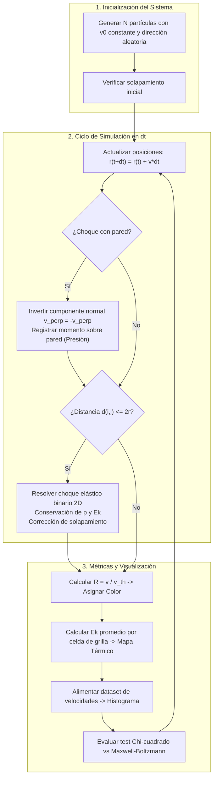
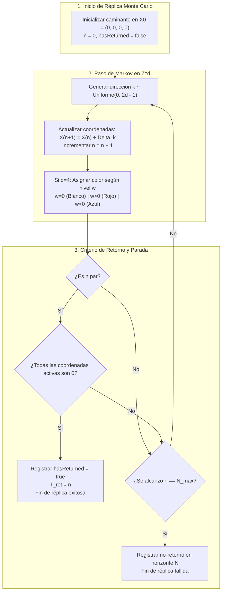
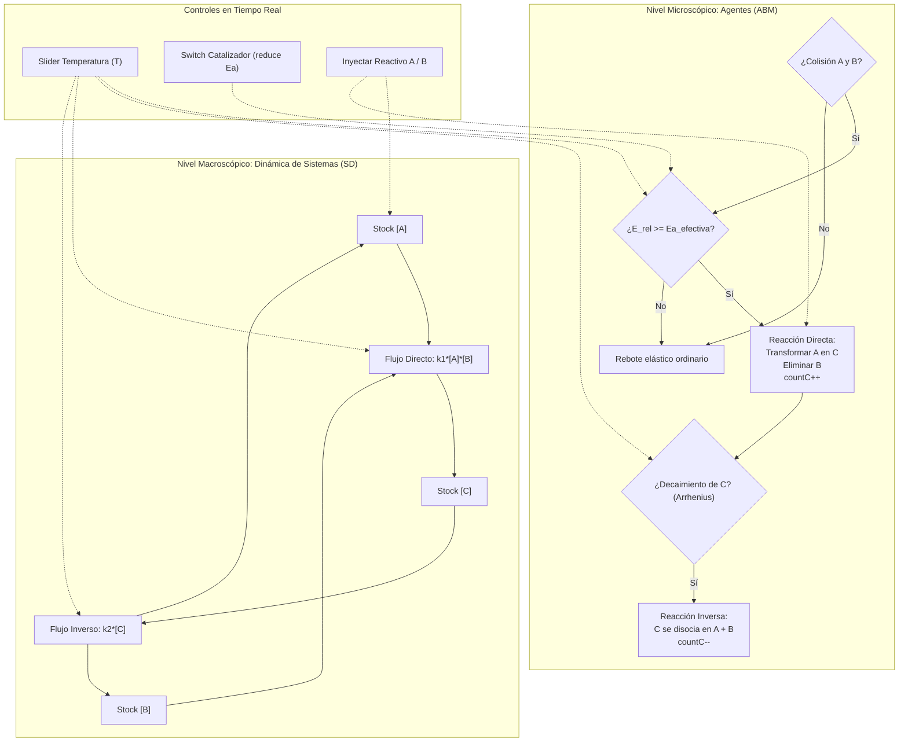

# Especificación Formal de Modelos de Simulación - TPI (UTN)

**Cátedra:** Simulación  
**Universidad Tecnológica Nacional (UTN)**  
**Documento:** Especificación Formal de Modelos de Simulación para los Tres Proyectos de TPI  
**Versión:** 1.0  
**Fecha:** Septiembre 2026  

---

# ÍNDICE GENERAL

1. [PROYECTO 1: Simulación del Gas Ideal y Distribución de Maxwell-Boltzmann con Mapa Térmico en AnyLogic](#proyecto-1-simulación-del-gas-ideal-y-distribución-de-maxwell-boltzmann-con-mapa-térmico-en-anylogic)
2. [PROYECTO 2: Caminatas Aleatorias Multidimensionales (1D a 4D), Teorema de Pólya y Espacios de Nivel en AnyLogic](#proyecto-2-caminatas-aleatorias-multidimensionales-1d-a-4d-teorema-de-pólya-y-espacios-de-nivel-en-anylogic)
3. [PROYECTO 3: Simulación Híbrida de Cinética Química, Equilibrio y Ley de Arrhenius en AnyLogic](#proyecto-3-simulación-híbrida-de-cinética-química-equilibrio-y-ley-de-arrhenius-en-anylogic)

---

## PROYECTO 1: Simulación del Gas Ideal y Distribución de Maxwell-Boltzmann con Mapa Térmico en AnyLogic

### 1. Sistema Seleccionado

Gas ideal bidimensional clásico confinado en un recinto cerrado bidimensional con paredes rígidas (adiabáticas o termostáticas), compuesto por una población de partículas esféricas indeformables que interactúan mediante colisiones elásticas bajo el paradigma de Modelado Basado en Agentes (ABM) en AnyLogic.

### 2. Descripción del Problema

En la Teoría Cinética de los Gases, la distribución de velocidades de las moléculas en equilibrio térmico no es uniforme ni determinista a nivel individual, sino que sigue la **Distribución de Maxwell-Boltzmann**, una propiedad macroscópica emergente de sucesivos choques aleatorios.  
El problema consiste en modelar computacionalmente el comportamiento micro-mecánico de partículas puntuales para:

- Demostrar la convergencia hacia el equilibrio (termalización) a partir de condiciones iniciales homogéneas fuera del equilibrio (ej. todas las partículas con idéntica velocidad inicial).
- Evaluar el impacto de la temperatura $T$ y masa $m$ en la curva de frecuencias de velocidades.
- Cuantificar la presión sobre las paredes y la difusión de energía mediante un **Mapa Térmico (Heatmap)** espacial en tiempo real ante la presencia de gradientes térmicos.

### 3. Límites del Sistema

- **Límites espaciales:** Recinto rectangular cerrado de dimensiones $L_x \times L_y$ (ej. $800 \times 600$ unidades de pantalla / coordenadas locales).
- **Límites de fronteras:** Cuatro paredes perimetrales rígidas e impermeables (izquierda, derecha, superior, inferior).
- **Límites temporales:** Simulación en tiempo continuo discretizado por paso de tiempo $\Delta t = 0.01\text{ s}$ hasta alcanzar el régimen estacionario de velocidades ($t \ge 100\text{ s}$).
- **Exclusiones del entorno:**
  - Fuerzas de campo gravitatorio o electromagnético externas (nulas).
  - Deformaciones inelásticas y pérdida de energía en forma de calor o sonido en los choques (nulas).
  - Radiación térmica al exterior del contenedor (nula).

### 4. Entidades

#### 4.1. Entidad Activa Dinámica: `Particle`

Representa cada una de las moléculas del gas ideal.

- **Atributos:**
  - `id`: Identificador numérico entero único.
  - `x`, `y`: Coordenadas de posición continua en el plano 2D ($\text{m}$ o $\text{px}$).
  - `vx`, `vy`: Componentes del vector velocidad $(\text{m/s})$.
  - `v`: Módulo de la velocidad escalar $v = \sqrt{v_x^2 + v_y^2}$.
  - `radius`: Radio geométrico de la esfera ($r \ge 1.0$).
  - `mass`: Masa inercial ($m > 0$).
  - `color`: Atributo visual dinámico mapeado a la razón térmica $R = v / v_{th}$.

#### 4.2. Entidad Estática / Entorno: `Main` (Recipiente y Espacio)

Representa el medio físico contenedor del gas.

- **Atributos:**
  - `width` ($L_x$), `height` ($L_y$): Dimensiones del contenedor.
  - `temperature` ($T$): Temperatura de consigna del sistema.
  - `kB`: Constante de Boltzmann efectiva (fijada en $1.0$).
  - `population`: Colección de agentes `particles` de tamaño $N$.

#### 4.3. Entidad Virtual de Instrumentación: `GridCell` (Celda del Mapa Térmico)

Subdivisión espacial regular del recinto en una malla $M \times M$ para cálculo de magnitudes intensivas locales.

- **Atributos:**
  - `row`, `col`: Coordenadas discretas en la grilla.
  - `localParticles`: Lista de partículas actualmente dentro de la celda.
  - `localTemperature`: Temperatura local calculada por energía cinética promedio.

### 5. Recursos

- **Análisis de Aplicabilidad:** En el modelado clásico de Dinámica Molecular / ABM **no existen servidores de atención ni recursos discretos convencionales** (como cajas o ventanillas de servicio).
- **Recurso Análogo / Espacial:** El **volumen libre del contenedor** actúa como un recurso físico compartido finito. A medida que aumenta el número de partículas $N$ o su radio $r$, el volumen excluido limita la movilidad libre, generando un incremento en la frecuencia de colisiones.

### 6. Procesos

1. **Proceso de Movimiento Rectilíneo Uniforme (Transporte Libre):**
   Entre colisiones consecutivas, cada partícula se traslada según las ecuaciones cinemáticas:
   $$x(t + dt) = x(t) + v_x \cdot dt$$
   $$y(t + dt) = y(t) + v_y \cdot dt$$

2. **Proceso de Colisión con Paredes (Reflexión Especular o Térmica):**
   - *Pared adiabática:* Invierte la componente normal de velocidad conservando la energía:
     - Si $x \le r \lor x \ge L_x - r \implies v_x = -v_x$
     - Si $y \le r \lor y \ge L_y - r \implies v_y = -v_y$
   - *Pared térmica (termostato a $T_w$):* La partícula rebota reescalando su velocidad según la distribución térmica impuesta por la pared.

3. **Proceso de Colisión Elástica Binaria Interparticular:**
   Ocurre cuando la distancia euclídea entre dos partículas $A$ y $B$ cumple $d(A, B) = \sqrt{(x_B - x_A)^2 + (y_B - y_A)^2} \le r_A + r_B$.
   - Se descompone la velocidad en la dirección normal $\hat{n} = \frac{\vec{r}_B - \vec{r}_A}{d}$ y tangencial $\hat{t}$.
   - Se conservan las componentes tangenciales y se intercambia momento lineal en el eje normal:
     $$v_{A,n}' = \frac{v_{A,n}(m_A - m_B) + 2 m_B v_{B,n}}{m_A + m_B}$$
     $$v_{B,n}' = \frac{v_{B,n}(m_B - m_A) + 2 m_A v_{A,n}}{m_A + m_B}$$
   - Se aplica corrección posicional anti-solapamiento: $\vec{r}_{nuevo} = \vec{r} \pm \frac{1}{2} (r_A + r_B - d) \hat{n}$.

4. **Proceso de Registro y Agrupación Térmica (Heatmap):**
   Periódicamente se calcula la energía cinética media en cada celda $k$ de la grilla y se proyecta el gradiente de color correspondiente.

### 7. Colas

- **Análisis de Aplicabilidad:** **No aplicable (N/A).** No se forman colas de espera; las colisiones e interacciones son colisiones mecánicas directas e instantáneas en el tiempo continuo.

### 8. Variables

#### 8.1. Variables de Estado

- $\{x_i(t), y_i(t)\}_{i=1}^N$: Vector posicional de todas las partículas en el instante $t$.
- $\{v_{x,i}(t), v_{y,i}(t)\}_{i=1}^N$: Vector velocidad de todas las partículas en el instante $t$.
- $E_{tot}(t) = \sum_{i=1}^N \frac{1}{2} m_i (v_{x,i}^2 + v_{y,i}^2)$: Energía cinética total acumulada en el sistema.
- $N_{col}(t)$: Contador acumulado de colisiones ocurridas.

#### 8.2. Variables de Entrada (Exógenas / Controlables)

- $N$: Número total de partículas presentes en el contenedor ($50 \le N \le 1000$).
- $T_{set}$: Temperatura fijada en el termostato o generador inicial.
- $m$: Masa de las partículas (o $m_1, m_2$ en mezclas binarias).
- $r$: Radio de las partículas.
- $L_x, L_y$: Dimensiones del recinto.
- $dt$: Paso de integración temporal de la simulación.

#### 8.3. Variables de Salida (Endógenas / Desempeño)

- $f_{obs}(v_k)$: Histograma de frecuencias de velocidades discretizado en $k$ intervalos.
- $v_{rms} = \sqrt{\frac{1}{N}\sum v_i^2}$: Velocidad cuadrática media observada.
- $v_{p,obs}$: Velocidad más probable empírica (moda del histograma).
- $P_{wall}$: Presión media sobre las paredes por unidad de tiempo y longitud:
  $$P_{wall} = \frac{\sum |\Delta p_\perp|}{2(L_x + L_y) \cdot \Delta t_{muestreo}}$$
- $T_{emp} = \frac{\langle E_k \rangle}{k_B}$: Temperatura termodinámica observada en el gas.

### 9. Parámetros

- $k_B = 1.0$: Constante de Boltzmann en unidades reducidas de simulación.
- $m_0 = 1.0$: Masa de referencia por defecto.
- $r_0 = 4.0\text{ px}$: Radio de visualización y detección de colisión.
- $dt = 0.01\text{ s}$: Paso de resolución numérica (Euler / Verlet en AnyLogic).
- Nivel de significancia para pruebas estadísticas: $\alpha = 0.05$.

### 10. Eventos

- `Ev_PasoTemporal` (Periódico, síncrono): Ocurre cada $\Delta t$; actualiza posiciones, resuelve colisiones y actualiza los indicadores.
- `Ev_ColisionPared` (Discreto condicional): Disparado cuando una partícula alcanza la frontera del recinto.
- `Ev_ColisionInterparticular` (Discreto condicional): Disparado cuando dos partículas cumplen la condición de solapamiento geométrico.
- `Ev_RefrescoHeatmap` (Periódico, tasa $10\text{ Hz}$): Recalcula temperaturas medias por cuadrícula para la UI.
- `Ev_PerturbacionUsuario` (Asíncrono): Cambio dinámico de temperatura vía Slider, inserción de fuentes de calor o cambio de volumen.

### 11. Estados

#### 11.1. Estados de la Entidad `Particle`

- `Vuelo_Libre`: La partícula se desplaza en línea recta sin colisión activa.
- `Impacto_Pared`: Se invierte el vector normal o se reajusta con el termostato.
- `Colision_Binaria`: Intercambio de momento elástico con otra partícula vecina.
- *Clasificación por Estado Energético:*
  - `Subtermica` ($v < 0.5 v_{th}$, Azul).
  - `Termica_Media` ($0.5 v_{th} \le v < 1.5 v_{th}$, Verde / Amarillo).
  - `Supratermica_ColaBoltzmann` ($v \ge 1.5 v_{th}$, Rojo).

#### 11.2. Estados del Sistema Global

- `Inicial_Desequilibrio`: Condiciones iniciales homogéneas (ej. todas las partículas con velocidad $v_0$ uniforme).
- `Transitorio_Termalizacion`: Ocurrencia masiva de colisiones redistribuyendo la energía cinética.
- `Equilibrio_MaxwellBoltzmann`: Estado estacionario dinámico con forma asimétrica estable en el histograma.

### 12. Relaciones entre Componentes

- **Partícula $\leftrightarrow$ Partícula:** Interacción desacoplada a distancia; acoplamiento cinemático fuerte por contacto instantáneo mediante conservación de momento e impulsión elástica.
- **Partícula $\leftrightarrow$ Pared:** Intercambio de momento mecánico que genera la presión macroscópica del gas ideal.
- **Población $\leftrightarrow$ Heatmap:** La suma de energías cinéticas locales alimenta el mapa de calor que retroalimenta la visualización del usuario.
- **Parámetros Globales $\leftrightarrow$ Partícula:** La temperatura fijada en `Main` escala el factor de color dinámico $v_{th} = \sqrt{\frac{2 k_B T}{m}}$.

### 13. Datos de Entrada

- Distribución inicial de posiciones: Uniforme aleatoria $x \sim U(r, L_x - r)$, $y \sim U(r, L_y - r)$ sin solapamiento inicial.
- Distribución inicial de velocidades (Caso de prueba de relajación): Módulo determinista $v_i = v_0 = \sqrt{2 k_B T / m}$, ángulo direccional $\theta_i \sim U(0, 2\pi)$.

### 14. Indicadores de Desempeño (KPIs)

1. **Conservación de la Energía Mecánica ($\Delta E\%$):**
   $$\Delta E\% = \frac{|E_{tot}(t) - E_{tot}(0)|}{E_{tot}(0)} \times 100\% \quad (\text{Criterio de éxito: } < 0.1\%)$$
2. **Estadístico de Bondad de Ajuste Chi-Cuadrado ($\chi^2$):**
   $$\chi_{calc}^2 = \sum_{k=1}^B \frac{(O_k - E_k)^2}{E_k}$$
   Donde $E_k = N \int_{bin_k} \frac{m v}{k_B T} \exp\left(-\frac{m v^2}{2 k_B T}\right) dv$. Si $\chi_{calc}^2 < \chi_{\alpha, B-1-p}^2$, el modelo se considera estadísticamente validado.
3. **Tiempo de Relajación ($\tau_{relajacion}$):** Número promedio de colisiones necesarias por partícula para que el estadístico $\chi^2$ no rechace la hipótesis nula de Maxwell-Boltzmann.
4. **Verificación de la Ley de Gases Ideales ($P \cdot A = N k_B T$):** Desvío porcentual entre la presión calculada por impactos y la predicha analíticamente.

### 15. Supuestos e Hipótesis Simplificativas

- Partículas modeladas como discos esféricos rígidos indeformables (2D).
- Choques binarios perfectamente elásticos (sin disipación de calor por fricción interna).
- Fuerzas de atracción/repulsión a distancia nulas (gas ideal clásico).
- Gravedad despreciable frente a la aceleración por choque térmico.
- Densidad molecular moderada para evitar colisiones triples simultáneas.

### 16. Preguntas de Simulación

1. ¿Cuántas colisiones por partícula se requieren para que un gas monoenergético alcance la distribución estacionaria de Maxwell-Boltzmann con un nivel de significancia $\alpha = 0.05$?
2. ¿Cómo se escala la velocidad más probable ($v_p$) y la dispersión del histograma al duplicar la temperatura $T$ del gas?
3. En una mezcla binaria de partículas con masas $m_1 = 1$ y $m_2 = 4$, ¿se verifica el principio de equipartición de energía ($\langle E_{k,1} \rangle = \langle E_{k,2} \rangle$) a pesar de que las velocidades medias sean dispares?
4. ¿Qué perfil estacionario de temperaturas se forma en el Mapa Térmico si la pared izquierda se mantiene a $500\text{ K}$ y la derecha a $100\text{ K}$ (conducción térmica de Fourier)?

### 17. Diagrama Conceptual Final

---

## PROYECTO 2: Caminatas Aleatorias Multidimensionales (1D a 4D), Teorema de Pólya y Espacios de Nivel en AnyLogic

### 1. Sistema Seleccionado

Proceso estocástico multidimensional discreto (Caminata Aleatoria Simple en retículos regulares $\mathbb{Z}^d$ con $d \in \{1, 2, 3, 4\}$) modelado mediante simulación de Monte Carlo basada en agentes en AnyLogic, instrumentado para la validación del Teorema de George Pólya y la foliación en espacios de nivel ($w = 0$).

### 2. Descripción del Problema

El **Teorema de Pólya (1921)** establece una transición de fase topológica fundamental en la teoría de probabilidades:

- En $1\text{D}$ y $2\text{D}$, la caminata aleatoria es **recurrente nula**: la probabilidad de retornar al origen en infinitos pasos es $P_{ret} = 1.0000$ ($100\%$).
- En $3\text{D}$ y $4\text{D}$, la caminata se vuelve **transiente**: la probabilidad de retorno es estrictamente menor a uno ($P_{3D} \approx 0.3405$, $P_{4D} \approx 0.1932$).

El problema consiste en modelar computacionalmente el comportamiento de los caminantes para:

- Estimar mediante Monte Carlo $\hat{P}_{ret}(N)$ para horizontes crecientes de pasos $N$.
- Resolver el desafío de visualización y análisis de la 4ta dimensión espacial mediante la técnica de **Espacios de Nivel (Slices)** fijando el hiperplano $w=0$.
- Caracterizar la distribución de los tiempos de primer retorno ($T_{ret}$) y verificar la propiedad estricta de paridad.

### 3. Límites del Sistema

- **Límites espaciales:** Retículo infinito $\mathbb{Z}^d$ no acotado (sin paredes físicas restrictivas para no forzar retornos por rebote).
- **Límites temporales / Horizonte de pasos:** Cada trayectoria individual se simula hasta un número máximo de saltos $N_{max} \in [100, 50\,000]$ o hasta que el caminante retorna al origen.
- **Límites muestrales:** Población de réplicas independientes $M \in [1000, 50\,000]$ corridas en lotes.
- **Exclusiones:**
  - Sin consideraciones de masa, aceleración continua ni fuerzas dinámicas.
  - Saltos homogéneos sin auto-evitación de caminos (no es SAW).

### 4. Entidades

#### 4.1. Entidad Activa Dinámica: `Walker` (Caminante)

Representa el agente estocástico que navega el espacio discreto.
- **Atributos:**
  - `id`: Identificador de la réplica.
  - `x`, `y`, `z`, `w`: Coordenadas enteras en $\mathbb{Z}^4$ (las coordenadas no usadas según la dimensión se fijan en $0$).
  - `steps`: Contador de pasos ejecutados $n$.
  - `hasReturned`: Booleano que indica si retornó al origen completo.
  - `returnTime`: Tiempo de primer retorno registrado $T_{ret}$.
  - `slice0_Visits`: Cantidad de veces que visita el hiperplano $w = 0$ en 4D.

#### 4.2. Entidad Controladora Global: `Main` / `SimulationExperiment`

Gestiona la ejecución de réplicas y compilación de estadísticas.

- **Atributos:**
  - `dimension` ($d$): Dimensión activa ($1, 2, 3$ o $4$).
  - `N_max`: Horizonte límite de pasos.
  - `totalReplicas` ($M$): Total de corridas programadas.
  - `successfulReturns`: Acumulador de réplicas que regresaron a $\vec{0}$.
  - `histogramData`: Colección de tiempos de primer retorno observados.

### 5. Recursos

- **Análisis de Aplicabilidad:** **No aplicable (N/A)** en el sentido de teoría de colas. No existen puestos de atención ni filas de procesamiento. El recurso limitante es la capacidad de memoria RAM y núcleos de CPU del host para procesar millones de transiciones pseudoaleatorias.

### 6. Procesos

1. **Proceso de Transición Estocástica (Salto de Markov):**
   En cada paso discreto $n$, el caminante elige con idéntica probabilidad $p = \frac{1}{2d}$ una dirección de desplazamiento entre los $2d$ vecinos ortogonales:
   $$\vec{X}_{n+1} = \vec{X}_n + \vec{\Delta}_k, \quad P(\vec{\Delta}_k) = \frac{1}{2d}$$
   - En 4D: $\vec{\Delta} \in \{(\pm 1, 0, 0, 0), (0, \pm 1, 0, 0), (0, 0, \pm 1, 0), (0, 0, 0, \pm 1)\}$.

2. **Proceso de Verificación de Retorno (Condición de Parada / Stopping Time):**
   Tras cada salto, si el contador de pasos $n$ es par ($n \equiv 0 \pmod 2$), se evalúa si todas las coordenadas activas son simultáneamente cero:
   $$x == 0 \land y == 0 \land (d < 3 \lor z == 0) \land (d < 4 \lor w == 0)$$
   Si la condición se cumple, se registra $T_{ret} = n$, se marca `hasReturned = true` y concluye la réplica.

3. **Proceso de Foliación e Instrumentación en Espacio de Nivel (4D):**
   Se evalúa la coordenada marginal $w_n$. Cada vez que $w_n = 0$, se comprueba si $(x, y, z) = (0,0,0)$. Esto permite demostrar que el retorno global a $\vec{0}$ es la intersección de estar en el nivel $w=0$ con el retorno tridimensional simultáneo.

### 7. Colas

- **Análisis de Aplicabilidad:** **No aplicable (N/A).** Las réplicas de Monte Carlo son totalmente independientes entre sí (proceso desacoplado / embarrassing parallel).

### 8. Variables

#### 8.1. Variables de Estado

- Vector de posición en el paso $n$: $\vec{X}_n = (x_n, y_n, z_n, w_n) \in \mathbb{Z}^d$.
- Número de pasos transcurridos: $n \in \{0, 1, 2, \dots, N_{max}\}$.
- Bandera booleana de estado de absorción/retorno: `hasReturned`.

#### 8.2. Variables de Entrada

- $d$: Dimensión espacial ($1, 2, 3, 4$).
- $N_{max}$: Horizonte de corte temporal ($10^2$ a $5 \times 10^4$).
- $M$: Cantidad de réplicas de Monte Carlo ($10^3$ a $5 \times 10^4$).
- $p_{drift}$: Probabilidad de sesgo (en escenario no-isotrópico).

#### 8.3. Variables de Salida

- $\hat{P}_{ret}(N) = \frac{\text{Retornos observados}}{M}$: Estimador de la probabilidad de retorno.
- Intervalo de confianza del $95\%$ para $\hat{P}_{ret}$.
- Frecuencia empírica de tiempos de primer retorno $f(T_{ret})$.
- Varianza espacial media empírica: $\langle R_n^2 \rangle = \frac{1}{M}\sum_{m=1}^M \|\vec{X}_{n,m}\|^2$.
- Razón de visitas al espacio de nivel: $\frac{\text{Visitas con } (x,y,z=0 \mid w=0)}{\text{Visitas totales a } w=0}$.

### 9. Parámetros

- Probabilidad por rama en salto uniforme: $p = \frac{1}{2d}$.
- Longitud de paso de red: $\Delta L = 1$.
- Constante del percentil normal: $Z_{0.975} = 1.96$ para intervalos de confianza al $95\%$.
- Valores analíticos teóricos de Pólya:
  - $P_{teorico}(1D) = 1.0000$
  - $P_{teorico}(2D) = 1.0000$
  - $P_{teorico}(3D) \approx 0.340537$
  - $P_{teorico}(4D) \approx 0.193202$

### 10. Eventos

- `Ev_PasoSalto` (Discreto recurrente): Generación de variable aleatoria uniforme en $[0, 2d-1]$ y traslación de la coordenada correspondiente.
- `Ev_RetornoOrigen` (Discreto condicional): Se verifica $\vec{X}_n = \vec{0}$; se almacena $T_{ret}$ y se finaliza la réplica.
- `Ev_LimitePasosAlcanzado` (Discreto condicional): $n == N_{max}$ sin retorno; se computa retorno fallido en el horizonte $N$.
- `Ev_CruceNivelCero` (Monitoreo): La variable $w$ cruza o alcanza el valor $0$ en una trayectoria 4D.

### 11. Estados

#### 11.1. Estados del Agente `Walker`

- `En_Exploracion`: La partícula se encuentra en movimiento activo fuera del origen ($n < N_{max}, \vec{X}_n \neq \vec{0}$).
- `Exito_Retornado`: Estado absorbente alcanzado cuando la partícula retorna al origen en el paso $n$.
- `Escape_En_Horizonte`: Estado final cuando expira el horizonte de pasos sin haber vuelto al origen.

#### 11.2. Estados del Experimento

- `Configuracion`: Asignación de $d, N, M$.
- `Ejecucion_MonteCarlo`: Procesamiento de réplicas en paralelo o por lotes.
- `Post_Procesamiento`: Construcción de histogramas e intervalos de confianza.

### 12. Relaciones entre Componentes

- **Propiedad de Markov Estricta:** El estado en el paso $n+1$ depende únicamente del estado en el paso $n$ y de la variable aleatoria del paso, sin memoria de pasos históricos.
- **Relación de Coordinadas 4D con la Visualización 3D:** El vector espacial tridimensional $(x, y, z)$ define la posición de la esfera en el canvas 3D de AnyLogic, mientras que la cuarta coordenada $w$ modula linealmente la componente espectral del color (Blanco si $w=0$, tonos cálidos si $w>0$, tonos fríos si $w<0$).

### 13. Datos de Entrada

- Coordenada de origen inicial: $\vec{X}_0 = (0, 0, 0, 0)$ en $n = 0$.
- Semilla pseudoaleatoria del generador uniforme discreto (`uniform_discr(0, 2*d - 1)`).

### 14. Indicadores de Desempeño (KPIs)

1. **Error Absoluto y Relativo contra Pólya:**
   $$\epsilon_{rel} = \frac{|\hat{P}_{ret}(N) - P_{teorico}|}{P_{teorico}} \times 100\%$$
2. **Estadístico Z de Contraste de Hipótesis para una Proporción:**
   $$Z = \frac{\hat{P}_{ret} - P_{teorico}}{\sqrt{\frac{P_{teorico}(1 - P_{teorico})}{M}}}$$
   (Criterio de validación: $|Z| < 1.96$ para $\alpha = 0.05$).
3. **Verificación de la Varianza Difusiva ($\langle R_n^2 \rangle = n$):** Coeficiente de determinación lineal $R^2 \ge 0.999$ al ajustar la distancia cuadrática media en función de $n$.
4. **Verificación de Paridad Estricta:** Comprobar que la frecuencia de retornos en pasos impares sea idénticamente nula ($P(T_{ret} = 2k+1) = 0$).

### 15. Supuestos e Hipótesis Simplificativas

- Red cartesiana $\mathbb{Z}^d$ homogénea, isotrópica e infinita.
- Probabilidades de salto simétricas e independientes en todas las direcciones axiales.
- El tiempo avanza en pulsos discretos unitarios ($\Delta n = 1$).
- El truncamiento por horizonte $N_{max}$ introduce un sesgo de subestimación analíticamente cuantificable en dimensiones recurrentes ($1D$ y $2D$) debido a que el tiempo medio de retorno diverge a infinito ($\mathbb{E}[T] = \infty$).

### 16. Preguntas de Simulación

1. ¿Qué porcentaje de retornos se observa experimentalmente en $1D, 2D, 3D$ y $4D$ fijando un horizonte de $N = 10\,000$ pasos y $M = 20\,000$ réplicas?
2. ¿Por qué en $2D$ la convergencia empírica hacia $1.0$ es logarítmica y significativamente más lenta que en $1D$ ($O(1/\ln N)$ vs $O(1/\sqrt{N})$)?
3. En $4D$, ¿con qué frecuencia la partícula visita el hiperplano de nivel $w=0$ sin lograr el retorno conjunto a $(0,0,0,0)$?
4. Si una partícula en $3D$ o $4D$ retorna al origen, ¿en qué porcentaje lo hace durante los primeros 50 pasos de su trayectoria?

### 17. Diagrama Conceptual Final

---

## PROYECTO 3: Simulación Híbrida de Cinética Química, Equilibrio y Ley de Arrhenius en AnyLogic

### 1. Sistema Seleccionado

Reactor químico estocástico-determinista cerrado de volumen constante con reacción bimolecular reversible de segundo orden:
$$A + B \underset{k_2}{\overset{k_1}{\rightleftharpoons}} C$$
gobernado microscópicamente por la Teoría de Colisiones y la Ley de Arrhenius (Modelado Basado en Agentes - ABM) y macroscópicamente por la Ley de Acción de Masas (Dinámica de Sistemas - SD) en AnyLogic.

### 2. Descripción del Problema

La velocidad de una reacción química y la posición del equilibrio dependen de factores microscópicos como la concentración de reactivos, la energía cinética térmica y la presencia de catalizadores que reducen la energía de activación $E_a$.  
El problema consiste en modelar y simular esta dinámica para:
- Observar el contraste y la convergencia entre el modelo individual estocástico con fluctuaciones moleculares (ABM) y el modelo determinista continuo de ecuaciones diferenciales (SD).
- Demostrar cuantitativamente la **Ley de Arrhenius** midiendo la constante cinética $k_1$ a distintas temperaturas $T$.
- Evaluar el **Principio de Le Chatelier** mediante perturbaciones térmicas y adición de reactivos en el equilibrio.
- Analizar el impacto de un catalizador sobre la velocidad de reacción sin alteración de la constante de equilibrio termodinámico $K_{eq}$.

### 3. Límites del Sistema

- **Límites espaciales:** Reactor bidimensional isotérmico de volumen constante $V = L_x \times L_y$ con paredes rígidas elásticas reflectantes.
- **Límites temporales:** Simulación continua en paso $\Delta t = 0.02\text{ s}$ hasta alcanzar el equilibrio dinámico ($t_{sim} \ge 300\text{ s}$).
- **Límites químicos:** Tres especies moleculares exclusivas: reactivo $A$, reactivo $B$, y producto compuesto $C$.
- **Exclusiones:**
  - Sin reacciones secundarias ni pérdidas hacia el exterior del reactor.
  - Efectos de disolvente y fuerzas viscosas de arrastre despreciables.
  - Reactor perfectamente agitado sin gradientes espaciales de densidad.

### 4. Entidades

#### 4.1. Entidad Dinámica: `Molecule`

Representa cada molécula individual presente en la mezcla reactiva.
- **Atributos:**
  - `id`: Identificador numérico único.
  - `type`: Tipo químico molecular (`TYPE_A = 0`, `TYPE_B = 1`, `TYPE_C = 2`).
  - `x`, `y`: Coordenadas de posición en el reactor.
  - `vx`, `vy`: Vector velocidad.
  - `mass`: Masa molecular ($m_A = 1.0, m_B = 1.0, m_C = 2.0$).
  - `radius`: Radio de colisión ($r_A = 4.0, r_B = 4.0, r_C = 6.0$).
  - `color`: Atributo estético (Azul para $A$, Amarillo para $B$, Verde para $C$).

#### 4.2. Entidad Entorno / Controlador: `Main`

Gobierna las condiciones termodinámicas y los modelos macroscópicos.
- **Atributos:**
  - `temperature` ($T$): Temperatura absoluta del termostato del reactor.
  - `Ea_direct` ($E_{a,1}$): Energía de activación de la reacción directa.
  - `Ea_reverse` ($E_{a,2}$): Energía de activación de la reacción inversa.
  - `isCatalystActive`: Booleano que conmuta la presencia de catalizador.
  - `countA`, `countB`, `countC`: Contadores poblacionales discretos en tiempo real.
  - `stockA`, `stockB`, `stockC`: Variables continuas del modelo de Dinámica de Sistemas.

### 5. Recursos

- **Análisis de Aplicabilidad:**
  - En fase homogénea libre: **No aplicable directamente (N/A).**
  - Con catalizador heterogéneo (opcional avanzado): Los **sitios activos del catalizador** operan como recursos de capacidad finita ($C_{sitios}$) donde las moléculas $A$ y $B$ deben adsorberse antes de reaccionar.

### 6. Procesos

1. **Proceso de Transporte Térmico Molecular:**
   Las moléculas se desplazan en el reactor con velocidades muestreadas según la temperatura $T$. Al alcanzar una pared perimetral, rebotan elásticamente.

2. **Proceso de Colisión Reactiva Directa ($A + B \xrightarrow{k_1} C$):**
   - Ocurre cuando colisionan una molécula $A$ y una molécula $B$ ($d \le r_A + r_B$).
   - Se calcula la energía cinética relativa a lo largo del eje normal de impacto:
     $$E_{rel} = \frac{1}{2} \mu (\vec{v}_{rel} \cdot \hat{n})^2, \quad \mu = \frac{m_A m_B}{m_A + m_B}$$
   - **Condición de Reacción:** Si $E_{rel} \ge E_{a,1}^{efectiva}$ (donde $E_{a,1}^{efectiva} = 0.4 \cdot E_{a,1}$ si hay catalizador activo):
     - Se fusionan $A$ y $B$: el agente $A$ muta a tipo $C$, adoptando el radio y masa correspondientes ($m_C = m_A + m_B$).
     - Se conserva la cantidad de movimiento lineal total:
       $$\vec{v}_C = \frac{m_A \vec{v}_A + m_B \vec{v}_B}{m_A + m_B}$$
     - Se remueve la molécula $B$ de la población activa.
     - Se decrementan los contadores $N_A$ y $N_B$, y se incrementa $N_C$.
   - Si $E_{rel} < E_{a,1}^{efectiva}$, rebotan elásticamente sin reaccionar.

3. **Proceso de Disociación Térmica Inversa ($C \xrightarrow{k_2} A + B$):**
   - Cada molécula de tipo $C$ evalúa estocásticamente su decaimiento en intervalos $\Delta t_{dec}$ con una probabilidad dada por Arrhenius:
     $$P_{decay} = 1 - \exp(-k_2(T) \cdot \Delta t_{dec}), \quad k_2(T) = \mathcal{A}_2 \exp\left(-\frac{E_{a,2}}{k_B T}\right)$$
   - Al cumplirse la probabilidad:
     - La molécula $C$ se convierte en una molécula $A$.
     - Se instancia una nueva molécula $B$ en la vecindad con impulso opuesto de disociación.
     - Se actualizan los contadores poblacionales.

4. **Proceso de Resolución Macroscópica Paralela (Dinámica de Sistemas):**
   Simultáneamente, AnyLogic integra numéricamente el sistema diferencial:
   $$\frac{d[A]}{dt} = -k_1 [A][B] + k_2 [C]$$
   $$\frac{d[B]}{dt} = -k_1 [A][B] + k_2 [C]$$
   $$\frac{d[C]}{dt} = +k_1 [A][B] - k_2 [C]$$

### 7. Colas

- **Análisis de Aplicabilidad:** **No aplicable (N/A)** en fase homogénea libre. En presencia de catalizador con capacidad limitada, las moléculas que chocan contra un sitio ocupado experimentan rechazo inmediato (comportamiento sin cola de espera o cola de longitud cero).

### 8. Variables

#### 8.1. Variables de Estado

- $N_A(t), N_B(t), N_C(t)$: Poblaciones discretas de agentes en cada instante.
- $[A](t), [B](t), [C](t)$: Concentraciones molares continuas en el diagrama de Stocks & Flows.
- $\{x_i, y_i, v_{x,i}, v_{y,i}, \text{type}_i\}$: Vector completo de estado de todos los agentes.

#### 8.2. Variables de Entrada

- Concentraciones iniciales: $N_{A,0}, N_{B,0}, N_{C,0}$.
- Temperatura del reactor: $T \in [50, 500]$ unidades de simulación.
- Energías de activación: $E_{a,1}, E_{a,2}$.
- Estado del catalizador: `isCatalystActive` ($\text{true} / \text{false}$).
- Volumen del reactor: $V = L_x \cdot L_y$.

#### 8.3. Variables de Salida

- Perfiles de concentración temporales $[A](t), [B](t), [C](t)$.
- Tiempo de vida media $t_{1/2}$ (tiempo para transformar el $50\%$ del reactivo limitante).
- Tiempo de arribo al equilibrio dinámico $t_{eq}$.
- Constante de equilibrio empírica observada:
  $$\hat{K}_{eq} = \frac{\langle N_C \rangle_{eq}}{\langle N_A \rangle_{eq} \cdot \langle N_B \rangle_{eq}}$$
- Constante de velocidad empírica directa observada $k_1(T)$.

### 9. Parámetros

- Constante de Boltzmann efectiva: $k_B = 1.0$.
- Factores pre-exponenciales de frecuencia: $\mathcal{A}_1 = 1.0, \mathcal{A}_2 = 0.5$.
- Parámetros por defecto: $E_{a,1} = 100.0$, $E_{a,2} = 150.0$ (Reacción exotérmica: $\Delta H = -50$).
- Radios moleculares: $r_A = 4.0, r_B = 4.0, r_C = 6.0$.
- Paso de tiempo: $dt = 0.02\text{ s}$.

### 10. Eventos

- `Ev_StepDinamico` (Periódico, síncrono): Desplazamiento y rebote contra paredes en cada $\Delta t$.
- `Ev_ColisionAB` (Condicional estocástico): Verificación y resolución de reacción directa $A+B \to C$.
- `Ev_DecaimientoC` (Periódico estocástico, tasa $10\text{ Hz}$): Muestreo del decaimiento inverso $C \to A+B$.
- `Ev_ActivacionCatalizador` (Discreto de usuario): Conmutación del booleano que escala la energía de activación.
- `Ev_InyeccionReactivos` (Discreto de perturbación): Inserción en vivo de $+50$ moléculas de $A$ o $B$.

### 11. Estados

#### 11.1. Estados del Agente `Molecule`

- `Especie_A`: Reactivo inicial A (Azul).
- `Especie_B`: Reactivo inicial B (Amarillo).
- `Especie_C`: Compuesto producto C (Verde).

#### 11.2. Estados del Reactor Global

- `Fase_Inicial`: Reactivos puros sin producto ($N_C = 0$).
- `Fase_Cinética_Rápida`: Máxima velocidad neta de reacción directa ($v_{dir} \gg v_{inv}$).
- `Equilibrio_Dinamico`: Las velocidades directa e inversa se igualan estocásticamente ($v_{dir} \approx v_{inv}$), manteniendo las poblaciones promedio en meseta estacionaria.

### 12. Relaciones entre Componentes

- **Balance Estequiométrico Estricto:** Por la conservación de masa:
  $$N_A(t) + N_C(t) = N_{A,0}$$
  $$N_B(t) + N_C(t) = N_{B,0}$$
- **Vínculo Multiparadigma (ABM $\leftrightarrow$ SD):** La tasa macroscópica de flujo continuo $v_1 = k_1 [A][B]$ en Dinámica de Sistemas converge al promedio temporal de colisiones exitosas del modelo de agentes.

### 13. Datos de Entrada

- Condiciones iniciales estándar: $N_{A,0} = 150$, $N_{B,0} = 150$, $N_{C,0} = 0$.
- Coordenadas generadas aleatoriamente en el plano sin solapamiento previo.

### 14. Indicadores de Desempeño (KPIs)

1. **Porcentaje de Conversión en Equilibrio ($\alpha_{eq}\%$):**
   $$\alpha_{eq}\% = \frac{N_{A,0} - \langle N_A \rangle_{eq}}{N_{A,0}} \times 100\%$$
2. **Error Relativo de la Constante de Equilibrio ($\epsilon_K\%$):**
   $$\epsilon_K\% = \frac{|\hat{K}_{eq} - K_{eq,teorico}|}{K_{eq,teorico}} \times 100\%$$
3. **Coeficiente de Correlación Lineal de Arrhenius ($R^2$):** Ajuste de la recta $\ln(k_1)$ vs $1/T$ para contrastar la energía de activación empírica con $E_{a,1}$.
4. **Discrepancia Cuadrática Media ABM vs SD:** Cuantificación del error de aproximación entre la curva con fluctuaciones discretas y la curva determinista continua.

### 15. Supuestos e Hipótesis Simplificativas

- Reacción elemental bimolecular directa de segundo orden y monomolecular inversa de primer orden.
- Mezcla reactiva ideal y homogénea en todo el volumen.
- No se consideran pérdidas de masa ni disipación inelástica no reactiva.
- La velocidad promedio de las moléculas responde instantáneamente al cambio de temperatura del termostato.

### 16. Preguntas de Simulación

1. ¿Cómo se modifica la velocidad inicial de formación de $C$ ($v_0$) ante 5 niveles crecientes de temperatura ($T = 100, 150, 200, 250, 300$), y valida el ajuste la Ley de Arrhenius?
2. ¿De qué manera la adición de un catalizador que reduce $E_{a,1}$ en un $60\%$ reduce el tiempo de vida media $t_{1/2}$ sin alterar el valor de $\hat{K}_{eq}$ final?
3. ¿Cómo responde el equilibrio dinámico microscópico frente a una inyección abrupta de reactivo $A$ (Principio de Le Chatelier)?
4. ¿A partir de qué número total de moléculas $N$ el ruido molecular relativo se reduce a menos del $2\%$ respecto a las ecuaciones diferenciales macroscópicas?

### 17. Diagrama Conceptual Final

