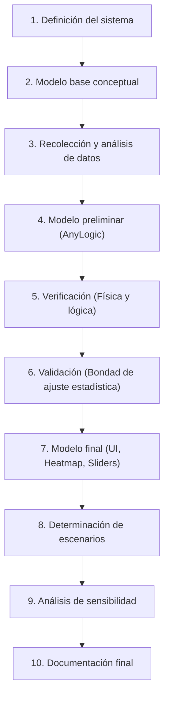

# Trabajo Práctico Integrador de Simulación - UTN
## Proyecto: Simulación del Gas Ideal y Distribución de Maxwell-Boltzmann con Mapa Térmico en AnyLogic

---

## 1. Explicación y Fundamentación del Proyecto

### 1.1. Contexto Físico y Teórico
La **Teoría Cinética de los Gases** y la **Estadística de Maxwell-Boltzmann** describen cómo se distribuyen las velocidades y energías cinéticas de las partículas (átomos o moléculas) en un gas ideal en equilibrio térmico.

En un gas clásico:
- Las partículas se mueven en trayectorias rectilíneas y colisionan elásticamente entre sí y contra las paredes del recipiente.
- Aunque inicialmente todas las partículas comiencen con la misma velocidad (o velocidades arbitrarias), las sucesivas colisiones aleatorias redistribuyen la energía cinética.
- El sistema converge naturalmente a un estado de equilibrio dinámico descripto por la **Distribución de Maxwell-Boltzmann**:
  
  $$f(v) \propto v \cdot \exp\left(-\frac{m v^2}{2 k_B T}\right) \quad (\text{en 2D})$$
  $$f(v) = 4\pi \left(\frac{m}{2\pi k_B T}\right)^{3/2} v^2 \exp\left(-\frac{m v^2}{2 k_B T}\right) \quad (\text{en 3D})$$

Donde:
- $v$: módulo de la velocidad de la partícula.
- $m$: masa de la partícula.
- $k_B$: constante de Boltzmann.
- $T$: temperatura absoluta (Kelvin), la cual es directamente proporcional a la energía cinética media: $\langle E_k \rangle = \frac{1}{2} m \langle v^2 \rangle = k_B T$ (en 2D).

### 1.2. ¿Por qué es un proyecto excelente para la cátedra de Simulación?
1. **Paradigma Basado en Agentes (ABM - Agent Based Modeling):** Cada partícula es un agente autónomo con posición $(x, y)$, vector velocidad $(v_x, v_y)$, masa y radio.
2. **Propiedad Emergente:** La distribución de Maxwell-Boltzmann no se programa explícitamente en el agente; **emerge** naturalmente de las micro-interacciones (choques elásticos).
3. **Visualización Avanzada en AnyLogic:**
   - **Coloreo individual dinámico:** Cada esfera/círculo cambia de color en tiempo real (por ejemplo, Azul $\rightarrow$ Cian $\rightarrow$ Verde $\rightarrow$ Amarillo $\rightarrow$ Rojo) según su velocidad instantánea respecto a la velocidad media.
   - **Mapa Térmico (Heat Map / Density Map):** Detección de zonas frías/calientes o de alta/baja densidad energética en el recinto, permitiendo simular fuentes de calor, paredes calefactoras o difusión térmica.
   - **Histograma en Tiempo Real:** Comparación directa entre el histograma de velocidades simuladas y la curva matemática teórica superpuesta.
   - **Interactividad en vivo:** Sliders para regular temperatura $T$, inyectar o extraer calor, variar masa $m$, volumen $V$ o cantidad de partículas $N$.

---

## 2. Desarrollo Paso a Paso Según la Metodología de Simulación

A continuación se detalla cómo abordar cada una de las 10 etapas requeridas por la cátedra:



---

### Paso 1: Definición del Sistema Bajo Estudio

* **Objetivo del estudio:** Analizar el comportamiento termodinámico y la convergencia hacia la distribución de Maxwell-Boltzmann en un gas ideal bidimensional confinado, evaluando el impacto de la variación de temperatura y fuentes térmicas en la distribución espacial de energía.
* **Límites del sistema:**
  - Recinto cerrado 2D (o 3D) de dimensiones $L_x \times L_y$.
  - Paredes rígidas que pueden ser adiabáticas (rebote especular sin cambio de energía) o termostáticas (intercambian calor al contacto).
* **Entidades y Atributos:**
  - **Agente `Particle`:** Posición $(x, y)$, velocidad $(v_x, v_y)$, módulo de velocidad $v = \sqrt{v_x^2 + v_y^2}$, masa $m$, radio $r$, color dinámico.
  - **Entorno `Main`:** Dimensiones del contenedor, número total de partículas $N$, temperatura deseada $T$, energía cinética total $E_{total}$, histograma de velocidades.
* **Variables del Sistema:**
  - *Variables de Entrada (Exógenas):* Temperatura fijada $T$, cantidad de partículas $N$, masa $m$, dimensiones de la caja.
  - *Variables de Estado:* Coordenadas y velocidades de todas las partículas en cada instante $t$.
  - *Variables de Salida (Endógenas):* Distribución de frecuencias de velocidades, velocidad cuadrática media $v_{rms}$, presión sobre las paredes (fuerza por unidad de longitud/tiempo), temperatura empírica calculada.
* **Hipótesis Simplificativas:**
  - Partículas esféricas indeformables.
  - Choques perfectamente elásticos (conservación de energía y momento).
  - Fuerzas intermoleculares nulas a distancia (sólo interactúan por contacto directo).
  - Efectos gravitatorios despreciables frente a la energía cinética térmica.

---

### Paso 2: Generación del Modelo de Simulación Base (Conceptual)

* **Paradigma:** Simulación Basada en Agentes (Agent-Based Modeling) con dinámica continua y detección de eventos de colisión en tiempo discreto ($\Delta t$).
* **Dinámica de Movimiento:**
  - En cada paso temporal $dt$:
    $$x(t + dt) = x(t) + v_x \cdot dt$$
    $$y(t + dt) = y(t) + v_y \cdot dt$$
* **Mecánica de Colisión contra Paredes:**
  - Si $x \le r$ o $x \ge L_x - r \implies v_x = -v_x$.
  - Si $y \le r$ o $y \ge L_y - r \implies v_y = -v_y$.
  - *(Opcional con pared térmica a temp $T_{wall}$):* la partícula rebota con una velocidad muestreada según la temperatura de la pared.
* **Mecánica de Colisión Elástica entre dos Partículas ($A$ y $B$):**
  - Ocurre cuando la distancia euclídea $d(A, B) \le r_A + r_B$.
  - Se descompone la velocidad en eje normal (línea que une centros) y tangencial. En el eje tangencial las velocidades se conservan; en el normal se intercambia momento lineal elásticamente:
    $$v_{A,n}' = \frac{v_{A,n}(m_A - m_B) + 2 m_B v_{B,n}}{m_A + m_B}$$
    $$v_{B,n}' = \frac{v_{B,n}(m_B - m_A) + 2 m_A v_{A,n}}{m_A + m_B}$$
* **Regla de Coloreo Térmico individual:**
  - Se define la velocidad media térmica $v_{th} = \sqrt{\frac{2 k_B T}{m}}$.
  - Razón $R = \frac{v}{v_{th}}$.
  - Asignación de color:
    - $R < 0.5$: Azul profundo (baja energía).
    - $0.5 \le R < 1.0$: Cian / Celeste.
    - $1.0 \le R < 1.5$: Verde / Amarillo.
    - $R \ge 1.5$: Rojo brillante (alta energía / cola de Boltzmann).

---

### Paso 3: Recolección y Análisis de Datos

* **Parámetros físicos:**
  - Definición de unidades de simulación (pueden ser unidades reducidas o del SI escaladas para evitar problemas de precisión numérica de $10^{-23}$ de $k_B$).
  - Fijar $k_B = 1$ en unidades normalizadas o escala adecuada para AnyLogic.
* **Distribución Teórica de Referencia:**
  - Deducción y cálculo de la función de densidad de probabilidad teórica 2D:
    $$f(v) = \frac{m v}{k_B T} \exp\left(-\frac{m v^2}{2 k_B T}\right)$$
  - Cálculo de parámetros clave esperados:
    - Moda (velocidad más probable): $v_p = \sqrt{\frac{k_B T}{m}}$.
    - Media: $\langle v \rangle = \sqrt{\frac{\pi k_B T}{2 m}} \approx 1.253 \, v_p$.
    - Cuadrática media: $v_{rms} = \sqrt{\frac{2 k_B T}{m}} \approx 1.414 \, v_p$.
* **Muestreo de datos en AnyLogic:**
  - Definir la tasa de refresco del Data Set (ej. registrar velocidades cada 0.1 unidades de tiempo) para alimentar el histograma.

---

### Paso 4: Generación de Modelo Preliminar en AnyLogic

* **Estructura en AnyLogic:**
  1. **Agente `Particle`:**
     - Variables: `vx`, `vy`, `v`, `radius`, `mass`.
     - Elemento gráfico: Óvalo o Esfera 3D con radio enlazado a `radius` y color enlazado dinámicamente a una función `getColor()`.
     - Evento cíclico o acción en el paso para mover y detectar colisiones con paredes.
  2. **Agente `Main`:**
     - Población de agentes: `particles` de tamaño $N$ (ej. $N = 200$ a $500$ partículas).
     - Parámetros: `temperature`, `boxWidth`, `boxHeight`.
     - Algoritmo de detección de colisiones:
       - Para $N$ moderado (200-500): doble bucle $O(N^2)$ optimizado o particionamiento espacial en grilla (Spatial Grid) para evitar caídas de FPS.
       - Corrección de solapamiento (anti-overlap positional correction) para evitar partículas pegadas.
  3. **Visualización preliminar:**
     - Canvas/Área rectangular con las partículas moviéndose y rebotando.
     - Gráfico básico de histograma (`Histogram`) recolectando `p.v` de todas las partículas.

---

### Paso 5: Verificación del Modelo

* **Objetivo:** Comprobar que el modelo computacional en AnyLogic funciona según la lógica programada y las leyes de la física.
* **Pruebas de verificación:**
  1. **Conservación de la Energía Cinética Total:**
     - En un sistema aislado con paredes reflectantes elásticas:
       $$E_{total}(t) = \sum_{i=1}^N \frac{1}{2} m_i (v_{x,i}^2 + v_{y,i}^2) \approx \text{constante}$$
     - Graficar $E_{total}$ vs. Tiempo. La deriva numérica debe ser prácticamente cero ($< 0.1\%$).
  2. **Conservación de la Cantidad de Movimiento:**
     - En cada choque entre partículas, verificar que $\vec{p}_{antes} = \vec{p}_{despues}$.
  3. **Verificación de condiciones de borde:**
     - Ninguna partícula debe escapar de los límites $[0, L_x]$ y $[0, L_y]$.
  4. **Prueba de simetría de velocidades:**
     - Las componentes $v_x$ y $v_y$ deben promediar cero ($\langle v_x \rangle \approx 0, \langle v_y \rangle \approx 0$) si no hay deriva de flujo global.

---

### Paso 6: Validación del Modelo

* **Objetivo:** Demostrar que el modelo reproduce el fenómeno del mundo real / teórico con significancia estadística.
* **Pruebas estadísticas de bondad de ajuste:**
  1. **Inicialización fuera de equilibrio (Prueba de Termalización):**
     - Inicializar **todas las partículas con exactamente la misma velocidad** $v_0$ apuntando en direcciones aleatorias (energía idéntica, delta de Dirac en el histograma).
     - Dejar evolucionar el sistema durante $t$ unidades de tiempo hasta que se produzcan suficientes colisiones ($> 10$ choques por partícula).
     - Observar si la distribución evoluciona espontáneamente hacia la curva acampanada asimétrica de Maxwell-Boltzmann.
  2. **Test Chi-Cuadrado ($\chi^2$) o Kolmogorov-Smirnov (K-S):**
     - Dividir el rango de velocidades en $k$ intervalos (bins).
     - Calcular frecuencias observadas $O_i$ a partir de la simulación en AnyLogic.
     - Calcular frecuencias teóricas esperadas $E_i = N \cdot \int_{bin_i} f(v) dv$.
     - Evaluar estadístico:
       $$\chi_{calc}^2 = \sum_{i=1}^k \frac{(O_i - E_i)^2}{E_i}$$
     - Contrastar contra el valor crítico $\chi_{\alpha, k-1-p}^2$ con nivel de significancia $\alpha = 0.05$.
     - Si no se rechaza $H_0$, queda formalmente validado que las partículas siguen la distribución de Maxwell-Boltzmann.

---

### Paso 7: Generación del Modelo Final

* **Incorporación de Características Avanzadas en AnyLogic:**
  1. **Controles Interactivos (UI):**
     - **Slider de Temperatura:** Permite al usuario calentar o enfriar el sistema en vivo reescalando velocidades o activando paredes térmicas.
     - **Slider de Número de Partículas $N$:** Añadir/quitar partículas dinámicamente.
     - **Botón de Inyección Térmica (Láser/Pared Caliente):** Genera perturbaciones localizadas para ver difusión.
  2. **Mapa Térmico (Heat Map / Density Map):**
     - Implementar una cuadrícula espacial de celdas $M \times M$ en el contenedor.
     - Cada celda calcula la energía cinética media local de las partículas presentes en ella:
       $$T_{local}(i, j) = \frac{1}{N_{celda}} \sum_{p \in celda} \frac{1}{2} m v_p^2$$
     - Representar visualmente con un mapa de calor semitransparente por detrás de las partículas (AnyLogic HeatMap / ShapeRectangle con opacidad y color interpolado).
  3. **Panel de Salidas e Indicadores:**
     - Display digital de $T_{actual}$, Presión media calculada por impacto $P = \frac{\sum \Delta p}{2 (L_x + L_y) \Delta t}$, $v_{rms}$ y Energía Total.
     - Gráfico superpuesto: Histograma AnyLogic + Curva continua teórica trazada con `Polyline` o `Plot`.

---

### Paso 8: Determinación de Escenarios para el Análisis

Diseñar un conjunto de corridas experimentales formales para el informe:

* **Escenario 1: Gas en Equilibrio a Distintas Temperaturas (Baja, Media, Alta):**
  - Evaluar cómo se ensancha y aplana la campana de Maxwell-Boltzmann a mayor temperatura.
  - Verificar que la velocidad más probable $v_p$ se desplaza como $\sqrt{T}$.
* **Escenario 2: Mezcla de Dos Gases (Partículas Pesadas vs. Ligeras):**
  - Introducir 50 partículas rojas de masa $m_1 = 4$ y 200 partículas azules de masa $m_2 = 1$.
  - Demostrar el teorema de equipartición de la energía: ambas especies alcanzan la misma energía cinética media $\langle E_k \rangle$, pero las livianas son mucho más veloces.
* **Escenario 3: Gradiente Térmico y Conducción (Pared Izquierda Caliente, Derecha Fría):**
  - La pared izquierda entrega energía en cada rebote ($T_{izq} = 500\text{ K}$) y la derecha absorbe energía ($T_{der} = 100\text{ K}$).
  - Observar en el **Mapa Térmico** la formación del perfil lineal de temperaturas y la transferencia de calor estacionaria (Ley de Fourier).
* **Escenario 4: Expansión Libre (Efecto Joule-Thomson en recipiente con tabique divisorio):**
  - Gas confinado en la mitad izquierda a alta densidad.
  - Se retira el tabique y se analiza la dispersión espacial y evolución temporal del mapa térmico hasta el nuevo equilibrio.

---

### Paso 9: Análisis de Sensibilidad

Evaluar la robustez y estabilidad del simulador frente a variaciones de parámetros:
* **Sensibilidad al paso de integración $\Delta t$:**
  - Probar valores de $dt = 0.001, 0.01, 0.05$. Evaluar el error numérico de solapamiento y la pérdida de conservación de energía.
* **Sensibilidad al tamaño de muestra $N$:**
  - Comparar $N = 50, 200, 1000$. Analizar la varianza del histograma y el valor $p$ del test de Chi-cuadrado (a mayor $N$, menor ruido estocástico).
* **Sensibilidad al radio de las partículas $r$ (Efecto de volumen excluido):**
  - Aumentar el radio $r$ para ver cuándo el comportamiento se desvía del gas ideal puntual y comienza a aproximarse a la ecuación de Van der Waals.

---

### Paso 10: Documentación Final y Conclusiones

* **Estructura del Informe de Cátedra (Memoria Técnica):**
  1. Carátula oficial y nombres de los integrantes.
  2. Introducción teórica y objetivos del trabajo.
  3. Formulación del modelo conceptual y diagrama de clases/agentes AnyLogic.
  4. Detalle de ecuaciones de colisión y algoritmo del coloreado / mapa térmico.
  5. Reporte de verificación y contrastación de validación estadística (tablas $\chi^2$).
  6. Resultados de los escenarios evaluados con capturas de pantalla del mapa de calor y gráficos comparativos.
  7. Conclusiones técnicas sobre el comportamiento del gas ideal y ventajas de la simulación basada en agentes.
  8. Manual de usuario para ejecutar el experimento en AnyLogic.
  9. Anexo con código Java de funciones clave (`onBeforeStep`, colisiones, cálculo del gradiente de color).

---

## 3. Ejemplo de Código Java Clave para AnyLogic

Para facilitar la implementación directa en AnyLogic, a continuación se detallan fragmentos de código Java recomendados para los agentes:

### 3.1. Función de Coloreo según Temperatura en el Agente `Particle`
```java
// Función getColor() dentro de Particle -> Retorna Color
double v = Math.sqrt(vx * vx + vy * vy);
double v_th = Math.sqrt(2 * main.kB * main.temperature / mass);
double ratio = v / v_th;

// Gradiente térmico suave (Azul -> Cian -> Verde -> Amarillo -> Rojo)
if (ratio < 0.5) {
    return new Color(0, 50, 255); // Azul frío
} else if (ratio < 1.0) {
    float factor = (float)((ratio - 0.5) / 0.5);
    return new Color(0, (int)(150 + 105 * factor), 255); // Cian
} else if (ratio < 1.5) {
    float factor = (float)((ratio - 1.0) / 0.5);
    return new Color((int)(255 * factor), 255, (int)(255 * (1 - factor))); // Verde a Amarillo
} else {
    float factor = (float)Math.min(1.0, (ratio - 1.5) / 1.0);
    return new Color(255, (int)(200 * (1 - factor)), 0); // Rojo caliente
}
```

### 3.2. Colisión Elástica entre Partículas en `Main`
```java
public void resolveCollision(Particle p1, Particle p2) {
    double dx = p2.x - p1.x;
    double dy = p2.y - p1.y;
    double dist = Math.sqrt(dx * dx + dy * dy);
    double minDist = p1.radius + p2.radius;

    if (dist < minDist && dist > 0) {
        // 1. Vector normal unitario
        double nx = dx / dist;
        double ny = dy / dist;

        // 2. Separación para evitar solapamiento (anti-sticking)
        double overlap = 0.5 * (minDist - dist);
        p1.x -= nx * overlap;
        p1.y -= ny * overlap;
        p2.x += nx * overlap;
        p2.y += ny * overlap;

        // 3. Velocidades en el eje normal
        double kx = p1.vx - p2.vx;
        double ky = p1.vy - p2.vy;
        double p = 2 * (nx * kx + ny * ky) / (p1.mass + p2.mass);

        // 4. Actualización elástica de velocidades
        p1.vx -= p * p2.mass * nx;
        p1.vy -= p * p2.mass * ny;
        p2.vx += p * p1.mass * nx;
        p2.vy += p * p1.mass * ny;
    }
}
```
