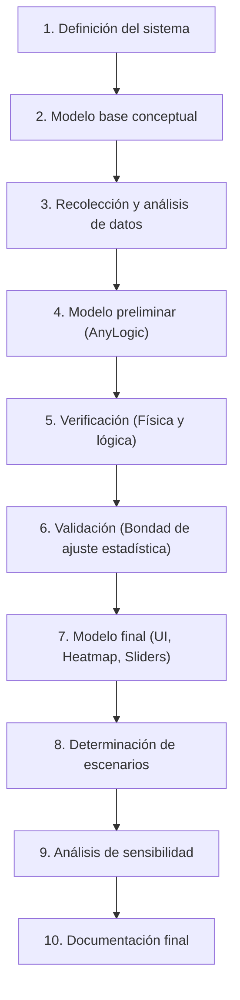

# Trabajo Práctico Integrador de Simulación - UTN

## Proyecto: Simulación del Gas Ideal y Distribución de Maxwell-Boltzmann con Mapa Térmico en AnyLogic

---

## Contenido de la carpeta

| Archivo | Qué es |
|---|---|
| `Boltzmann/Boltzmann.alp` | **Modelo final** (nombre interno `Boltzmann_EXP`). Incluye la interfaz con selector de escenarios y los experimentos de Parameters Variation. |
| `Boltzmann/consolaexp1.txt` a `consolaexp4.txt` | Salida de consola de los experimentos `Esc1_Temperatura`, `Esc2_Mezcla`, `Esc3_Gradiente` y `Esc4_Joule`, sin modificar. |
| `Resultados_Fisica.xlsx` | Parámetros por escenario, corridas, resúmenes con test t y lectura general. Las hojas `*_Resumen` tienen fórmulas vivas sobre las hojas `*_Corridas`. |
| `readme.md` | Este documento. |

Cómo reproducir:
1. Abrir `Boltzmann/Boltzmann.alp` en AnyLogic 8.9. El experimento `Simulation` abre la interfaz interactiva (la ventana necesita aproximadamente 1520 x 740 píxeles).
2. Para los datos de los escenarios, correr cada experimento (`Esc1_Temperatura`, `Esc2_Mezcla`, `Esc3_Gradiente`, `Esc4_Joule`). Cada uno imprime en la consola el CSV de todas las corridas, la media y el desvío por grupo, y el test t pareado.
3. Copiar la consola a los `consolaexp*.txt` y pegarla en las hojas `*_Corridas` del Excel.
4. `Esc3_Gradiente` es el más largo (hasta 200 s de modelo con N = 2000). Conviene correr primero una sola réplica para medir el tiempo.

---

## 1. Explicación y Fundamentación del Proyecto

### 1.1. Contexto Físico y Teórico

La **Teoría Cinética de los Gases** y la **Estadística de Maxwell-Boltzmann** describen cómo se distribuyen las velocidades y energías cinéticas de las partículas (átomos o moléculas) en un gas ideal en equilibrio térmico.

En un gas clásico:

- Las partículas se mueven en trayectorias rectilíneas y colisionan elásticamente entre sí y contra las paredes del recipiente.
- Aunque inicialmente todas las partículas comiencen con la misma velocidad (o velocidades arbitrarias), las sucesivas colisiones aleatorias redistribuyen la energía cinética.
- El sistema converge naturalmente a un estado de equilibrio dinámico descripto por la **Distribución de Maxwell-Boltzmann**:
  
  $$f(v) \propto v \cdot \exp\left(-\frac{m v^2}{2 k_B T}\right) \quad (\text{en 2D})$$
  $$f(v) = 4\pi \left(\frac{m}{2\pi k_B T}\right)^{3/2} v^2 \exp\left(-\frac{m v^2}{2 k_B T}\right) \quad (\text{en 3D})$$

Donde:

- $v$: módulo de la velocidad de la partícula.
- $m$: masa de la partícula.
- $k_B$: constante de Boltzmann.
- $T$: temperatura absoluta (Kelvin), la cual es directamente proporcional a la energía cinética media: $\langle E_k \rangle = \frac{1}{2} m \langle v^2 \rangle = k_B T$ (en 2D).

> **Unidades usadas en el modelo:** unidades reducidas con $k_B = 1$ y masa de referencia 1. La temperatura es entonces $T = \langle E_k \rangle$ y se expresa en esas unidades (no en kelvin). Las longitudes están en unidades del modelo (caja de 600 x 400).

### 1.2. ¿Por qué?

1. **Paradigma Basado en Agentes (ABM - Agent Based Modeling):** Cada partícula es un agente autónomo con posición $(x, y)$, vector velocidad $(v_x, v_y)$, masa y radio.
2. **Propiedad Emergente:** La distribución de Maxwell-Boltzmann no se programa explícitamente en el agente; **emerge** naturalmente de las micro-interacciones (choques elásticos).
3. **Visualización Avanzada en AnyLogic:**
   - **Coloreo individual dinámico:** Cada círculo cambia de color en tiempo real (Azul $\rightarrow$ Cian $\rightarrow$ Verde $\rightarrow$ Amarillo $\rightarrow$ Rojo) según su velocidad instantánea respecto a la velocidad térmica.
   - **Mapa Térmico (Heat Map / Density Map):** Detección de zonas frías/calientes o de alta/baja densidad en el recinto, permitiendo simular paredes calefactoras o difusión térmica.
   - **Histograma en Tiempo Real:** Comparación directa entre el histograma de velocidades simuladas y la curva matemática teórica superpuesta.
   - **Interactividad en vivo:** Sliders para regular la temperatura $T$ y la cantidad de partículas $N$, y selectores de escenario, paredes, mapa y condición inicial.

---

## 2. Desarrollo Paso a Paso Según la Metodología de Simulación

A continuación se detalla cómo se abordó cada una de las 10 etapas requeridas por la cátedra. Cada paso termina con un bloque **Implementación** que indica qué se hizo y qué cambió respecto del plan original.



---

### Paso 1: Definición del Sistema Bajo Estudio

* **Objetivo del estudio:** Analizar el comportamiento termodinámico y la convergencia hacia la distribución de Maxwell-Boltzmann en un gas ideal bidimensional confinado, evaluando el impacto de la variación de temperatura y fuentes térmicas en la distribución espacial de energía.
* **Límites del sistema:**
  - Recinto cerrado 2D de dimensiones $L_x \times L_y$.
  - Paredes rígidas que pueden ser adiabáticas (rebote especular sin cambio de energía) o termostáticas (intercambian calor al contacto).
* **Entidades y Atributos:**
  - **Agente `Particle`:** Posición $(x, y)$, velocidad $(v_x, v_y)$, módulo de velocidad $v = \sqrt{v_x^2 + v_y^2}$, masa $m$, radio $r$, color dinámico.
  - **Entorno `Main`:** Dimensiones del contenedor, número total de partículas $N$, temperatura deseada $T$, energía cinética total $E_{total}$, histograma de velocidades.
* **Variables del Sistema:**
  - *Variables de Entrada (Exógenas):* Temperatura fijada $T$, cantidad de partículas $N$, masa $m$, dimensiones de la caja.
  - *Variables de Estado:* Coordenadas y velocidades de todas las partículas en cada instante $t$.
  - *Variables de Salida (Endógenas):* Distribución de frecuencias de velocidades, velocidad cuadrática media $v_{rms}$, presión sobre las paredes (fuerza por unidad de longitud/tiempo), temperatura empírica calculada.
* **Hipótesis Simplificativas:**
  - Partículas esféricas indeformables.
  - Choques perfectamente elásticos (conservación de energía y momento).
  - Fuerzas intermoleculares nulas a distancia (sólo interactúan por contacto directo).
  - Efectos gravitatorios despreciables frente a la energía cinética térmica.

**Implementación:** `Particle` tiene `vx`, `vy`, `mass`, `radius` y un contador de choques. `Main` tiene la población `particles`, el espacio continuo de 600 x 400 y los parámetros `N`, `T`, `Lx`, `Ly`, `dt`, `wallMode`, `TL`, `TR`, `N1`, `m1`, `initMode`, `mapMode` y `kB`.

---

### Paso 2: Generación del Modelo de Simulación Base (Conceptual)

* **Paradigma:** Simulación Basada en Agentes (Agent-Based Modeling) con dinámica continua y detección de eventos de colisión en tiempo discreto ($\Delta t$).
* **Dinámica de Movimiento:**
  - En cada paso temporal $dt$:
    $$x(t + dt) = x(t) + v_x \cdot dt$$
    $$y(t + dt) = y(t) + v_y \cdot dt$$
* **Mecánica de Colisión contra Paredes:**
  - Si $x \le r$ o $x \ge L_x - r \implies v_x = -v_x$.
  - Si $y \le r$ o $y \ge L_y - r \implies v_y = -v_y$.
  - *(Opcional con pared térmica a temp $T_{wall}$):* la partícula rebota con una velocidad muestreada según la temperatura de la pared.
* **Mecánica de Colisión Elástica entre dos Partículas ($A$ y $B$):**
  - Ocurre cuando la distancia euclídea $d(A, B) \le r_A + r_B$.
  - Se descompone la velocidad en eje normal (línea que une centros) y tangencial. En el eje tangencial las velocidades se conservan; en el normal se intercambia momento lineal elásticamente:
    $$v_{A,n}' = \frac{v_{A,n}(m_A - m_B) + 2 m_B v_{B,n}}{m_A + m_B}$$
    $$v_{B,n}' = \frac{v_{B,n}(m_B - m_A) + 2 m_A v_{A,n}}{m_A + m_B}$$
* **Regla de Coloreo Térmico individual:**
  - Se define la velocidad térmica $v_{th} = \sqrt{\frac{2 k_B T}{m}}$.
  - Razón $R = \frac{v}{v_{th}}$.
  - Asignación de color: azul (baja energía) para $R$ pequeño, pasando por cian, verde y amarillo, hasta rojo (alta energía, cola de Boltzmann) para $R$ grande.

**Implementación — cambios respecto del plan:**
- El rebote contra pared térmica no es una velocidad fija: la componente normal se muestrea de una distribución de Rayleigh y la tangencial de una gaussiana, ambas con la temperatura de la pared. Es la forma correcta de muestrear un flujo que sale de una pared.
- La pared izquierda usa `TL` y la derecha `TR`. Las paredes superior e inferior son siempre adiabáticas.
- El coloreo no usa umbrales discretos sino un gradiente continuo de cinco colores. El parámetro del gradiente es $R/2$ con $R = v/v_{th}$, y $v_{th}$ se calcula con la temperatura medida en ese instante (`Tmeas`), no con la nominal. Ver el código en la sección 3.1.
- Cuando hay una especie pesada (escenario 2), esas partículas se dibujan con borde negro grueso.

---

### Paso 3: Recolección y Análisis de Datos

* **Parámetros físicos:**
  - Definición de unidades de simulación (pueden ser unidades reducidas o del SI escaladas para evitar problemas de precisión numérica de $10^{-23}$ de $k_B$).
  - Fijar $k_B = 1$ en unidades normalizadas o escala adecuada para AnyLogic.
* **Distribución Teórica de Referencia:**
  - Deducción y cálculo de la función de densidad de probabilidad teórica 2D:
    $$f(v) = \frac{m v}{k_B T} \exp\left(-\frac{m v^2}{2 k_B T}\right)$$
  - Cálculo de parámetros clave esperados:
    - Moda (velocidad más probable): $v_p = \sqrt{\frac{k_B T}{m}}$.
    - Media: $\langle v \rangle = \sqrt{\frac{\pi k_B T}{2 m}} \approx 1.253 \, v_p$.
    - Cuadrática media: $v_{rms} = \sqrt{\frac{2 k_B T}{m}} \approx 1.414 \, v_p$.
* **Muestreo de datos en AnyLogic:**
  - Definir la tasa de refresco del Data Set (ej. registrar velocidades cada 0.1 unidades de tiempo) para alimentar el histograma.

**Implementación:** el histograma se actualiza cada 0.1 s de modelo con 50 bins sobre un eje fijo de velocidades (`vMaxFixed = 300`). En vez de promediar todo el historial se usa un promedio móvil exponencial (`alphaH = 0.01`, ventana de unos 10 s), para que el transitorio de la termalización no quede oculto por fotos viejas. Los datasets de la curva teórica se calculan con la $f(v)$ de arriba y la temperatura medida.

---

### Paso 4: Generación de Modelo Preliminar en AnyLogic

* **Estructura en AnyLogic:**
  1. **Agente `Particle`:**
     - Variables: `vx`, `vy`, `v`, `radius`, `mass`.
     - Elemento gráfico: Óvalo con radio enlazado a `radius` y color enlazado dinámicamente a la función de coloreo.
     - Evento cíclico o acción en el paso para mover y detectar colisiones con paredes.
  2. **Agente `Main`:**
     - Población de agentes: `particles` de tamaño $N$ (ej. $N = 200$ a $500$ partículas).
     - Parámetros: `T`, `Lx`, `Ly`.
     - Algoritmo de detección de colisiones:
       - Para $N$ moderado (200-500): doble bucle $O(N^2)$ optimizado o particionamiento espacial en grilla (Spatial Grid) para evitar caídas de FPS.
       - Corrección de solapamiento (anti-overlap positional correction) para evitar partículas pegadas.
  3. **Visualización preliminar:**
     - Canvas/Área rectangular con las partículas moviéndose y rebotando.
     - Gráfico básico de histograma (`Histogram`) recolectando `p.v` de todas las partículas.

**Implementación — cambios respecto del plan:**
- AnyLogic 8.9 Personal Learning Edition no permite el trigger cíclico de los eventos ni la animación de agentes con un óvalo propio. La física corre en un evento `Timeout` con modo recurrente y período `dt` (`ev_step`), que llama a `stepPhysics()`. El agente `Particle` se dibuja con animación *None* y el óvalo se replica desde `Main` (`particles.size()` copias), con posición, radio y color tomados de cada agente.
- La detección de colisiones usa una grilla de celdas (linked-cell), con celdas del tamaño del diámetro máximo, y compara cada partícula solo con su celda y las cuatro vecinas de adelante. Es $O(N)$ en vez de $O(N^2)$.
- Hay corrección posicional de solapamiento, y el choque solo se resuelve si las partículas se acercan (componente normal de la velocidad relativa positiva). Ver el código en la sección 3.2.
- El mapa de calor es una replicación de $M \times M$ rectángulos semitransparentes (alfa 120).

---

### Paso 5: Verificación del Modelo

* **Objetivo:** Comprobar que el modelo computacional en AnyLogic funciona según la lógica programada y las leyes de la física.
* **Pruebas de verificación:**
  1. **Conservación de la Energía Cinética Total:**
     - En un sistema aislado con paredes reflectantes elásticas:
       $$E_{total}(t) = \sum_{i=1}^N \frac{1}{2} m_i (v_{x,i}^2 + v_{y,i}^2) \approx \text{constante}$$
     - Graficar $E_{total}$ vs. Tiempo. La deriva numérica debe ser prácticamente cero ($< 0.1\%$).
  2. **Conservación de la Cantidad de Movimiento:**
     - En cada choque entre partículas, verificar que $\vec{p}_{antes} = \vec{p}_{despues}$.
  3. **Verificación de condiciones de borde:**
     - Ninguna partícula debe escapar de los límites $[0, L_x]$ y $[0, L_y]$.
  4. **Prueba de simetría de velocidades:**
     - Las componentes $v_x$ y $v_y$ deben promediar cero ($\langle v_x \rangle \approx 0, \langle v_y \rangle \approx 0$) si no hay deriva de flujo global.

**Implementación y resultado:**
- **Energía:** la interfaz grafica la desviación relativa $\Delta E / E_0$ (en partes por millón) y muestra la deriva en el panel de verificación. En los 40 experimentos del escenario 4 (paredes adiabáticas y tabique elástico) la deriva fue **menor que $10^{-8}$ ppm**, es decir del orden de $10^{-15}$ en relativo, que es el error de redondeo de la doble precisión. Con paredes térmicas la energía no se conserva y ese gráfico no aplica.
- **Momento y energía por choque:** en cada choque se calculan el momento y la energía del par antes y después, y se guarda el error máximo (`momErr`, `eErr`). Se muestran en el panel de verificación.
- **Simetría:** el panel muestra $\langle v_x \rangle$ y $\langle v_y \rangle$ junto con la banda esperable de $\pm 2\sigma/\sqrt{N}$.
- **Límites de la caja:** las posiciones se acotan a $[r, L - r]$ en cada paso.

---

### Paso 6: Validación del Modelo

* **Objetivo:** Demostrar que el modelo reproduce el fenómeno del mundo real / teórico con significancia estadística.
* **Pruebas estadísticas de bondad de ajuste:**
  1. **Inicialización fuera de equilibrio (Prueba de Termalización):**
     - Inicializar **todas las partículas con exactamente la misma velocidad** $v_0$ apuntando en direcciones aleatorias (energía idéntica, delta de Dirac en el histograma).
     - Dejar evolucionar el sistema durante $t$ unidades de tiempo hasta que se produzcan suficientes colisiones ($> 10$ choques por partícula).
     - Observar si la distribución evoluciona espontáneamente hacia la curva acampanada asimétrica de Maxwell-Boltzmann.
  2. **Test Chi-Cuadrado ($\chi^2$) o Kolmogorov-Smirnov (K-S):**
     - Dividir el rango de velocidades en $k$ intervalos (bins).
     - Calcular frecuencias observadas $O_i$ a partir de la simulación en AnyLogic.
     - Calcular frecuencias teóricas esperadas $E_i = N \cdot \int_{bin_i} f(v) dv$.
     - Evaluar estadístico:
       $$\chi_{calc}^2 = \sum_{i=1}^k \frac{(O_i - E_i)^2}{E_i}$$
     - Contrastar contra el valor crítico $\chi_{\alpha, k-1-p}^2$ con nivel de significancia $\alpha = 0.05$.
     - Si no se rechaza $H_0$, queda formalmente validado que las partículas siguen la distribución de Maxwell-Boltzmann.

**Implementación y resultado:**
- **Test $\chi^2$:** se usan $k = 10$ bins **equiprobables** (definidos con la función de distribución acumulada $F(v) = 1 - e^{-m v^2 / 2 k_B T}$), de modo que todas las frecuencias esperadas valen $N/k$. Los grados de libertad son $k - 2$ porque $T$ se estima de los mismos datos. Se evalúa cada 5 s de modelo y el modelo cuenta cuántas fotos rechazan $H_0$.
- **Qué significa el resultado:** a nivel 0.05, un gas realmente Maxwell-Boltzmann rechaza el 5 % de las fotos por azar. Una sola foto no valida nada; lo informativo es la **fracción de rechazos**. En los escenarios 1 y 2 se obtuvo **4.5 %** (aprox. 1080 fotos en el 1 y 960 en el 2), compatible con el 5 % esperado.
- **Termalización desde `initMode = 0`:** el selector "Todas con la misma rapidez" está implementado en la interfaz (junto al botón Reiniciar), pero la prueba formal de termalización **no se corrió todavía** (ver pendientes). Todos los experimentos de este trabajo arrancan en equilibrio (`initMode = 1`).

---

### Paso 7: Generación del Modelo Final

* **Incorporación de Características Avanzadas en AnyLogic:**
  1. **Controles Interactivos (UI):**
     - **Slider de Temperatura:** Permite al usuario calentar o enfriar el sistema en vivo reescalando velocidades o activando paredes térmicas.
     - **Slider de Número de Partículas $N$:** Añadir/quitar partículas dinámicamente.
     - **Botón de Inyección Térmica (Láser/Pared Caliente):** Genera perturbaciones localizadas para ver difusión.
  2. **Mapa Térmico (Heat Map / Density Map):**
     - Implementar una cuadrícula espacial de celdas $M \times M$ en el contenedor.
     - Cada celda calcula la energía cinética media local de las partículas presentes en ella:
       $$T_{local}(i, j) = \frac{1}{N_{celda}} \sum_{p \in celda} \frac{1}{2} m v_p^2$$
     - Representar visualmente con un mapa de calor semitransparente por detrás de las partículas (AnyLogic HeatMap / ShapeRectangle con opacidad y color interpolado).
  3. **Panel de Salidas e Indicadores:**
     - Display digital de $T_{actual}$, Presión media calculada por impacto $P = \frac{\sum \Delta p}{2 (L_x + L_y) \Delta t}$, $v_{rms}$ y Energía Total.
     - Gráfico superpuesto: Histograma AnyLogic + Curva continua teórica trazada con `Polyline` o `Plot`.

**Implementación — cambios respecto del plan:**
- **Selector de escenario (1 a 4):** botones de radio en `Main`. Cada escenario carga sus parámetros de partida (la función `setScenario(k)`), reinicia el modelo y muestra solo los gráficos que le corresponden. El modelo arranca siempre en el escenario 1.
- **Controles:** slider de temperatura, slider de $N$, selectores de paredes (adiabáticas o térmicas), de mapa (temperatura o densidad) y de condición inicial, botón Reiniciar, y controles propios de cada escenario (sliders de `TL` y `TR` en el 3, botones de iniciar Joule y retirar tabique en el 4, botones para guardar histogramas en el 1).
- **Mapa de calor:** dos modos. Temperatura local con escala `Tmin` a `Tmax`, o densidad local, donde el rojo corresponde al doble de la densidad media.
- **Indicadores:** temperatura medida, $v_{rms}$, energía total, $N$, choques por partícula, presión medida y presión ideal corregida por el área excluida, $\chi^2$ con su $p$-valor, y los indicadores de verificación del paso 5.
- **No se implementó** el botón de inyección térmica localizada. Se reemplazó por las paredes térmicas del escenario 3, que cubren el mismo objetivo (difusión de calor).
- **Gráficos por escenario:**
  - Esc. 1: histograma contra curva teórica, $\langle v \rangle$ contra $\sqrt{T}$ (dataset `dsVT`), tres histogramas en unidades reducidas contra la curva universal (`dsH1` a `dsH3`).
  - Esc. 2: histograma por especie con las dos curvas teóricas, $\langle E_k \rangle$ de cada especie contra el tiempo, y cociente de $v_{rms}$ contra $\sqrt{m_1}$.
  - Esc. 3: perfil $T(x)$ con ajuste lineal sobre la zona central, y flujos de energía $q_L$, $q_R$ y su suma contra el tiempo.
  - Esc. 4: fracción de partículas a la izquierda contra el tiempo, y $\Delta E / E_0$ en ppm.

---

### Paso 8: Determinación de Escenarios para el Análisis

Diseñar un conjunto de corridas experimentales formales para el informe:

* **Escenario 1: Gas en Equilibrio a Distintas Temperaturas (Baja, Media, Alta):**
  - Evaluar cómo se ensancha y aplana la campana de Maxwell-Boltzmann a mayor temperatura.
  - Verificar que la velocidad más probable $v_p$ se desplaza como $\sqrt{T}$.
* **Escenario 2: Mezcla de Dos Gases (Partículas Pesadas vs. Ligeras):**
  - Introducir 50 partículas rojas de masa $m_1 = 4$ y 200 partículas azules de masa $m_2 = 1$.
  - Demostrar el teorema de equipartición de la energía: ambas especies alcanzan la misma energía cinética media $\langle E_k \rangle$, pero las livianas son mucho más veloces.
* **Escenario 3: Gradiente Térmico y Conducción (Pared Izquierda Caliente, Derecha Fría):**
  - La pared izquierda entrega energía en cada rebote y la derecha absorbe energía.
  - Observar en el **Mapa Térmico** la formación del perfil lineal de temperaturas y la transferencia de calor estacionaria (Ley de Fourier).
* **Escenario 4: Expansión Libre de Joule (recipiente con tabique divisorio):**
  - Gas confinado en la mitad izquierda a alta densidad.
  - Se retira el tabique y se analiza la dispersión espacial y evolución temporal del mapa de densidad hasta el nuevo equilibrio.

**Cambios respecto del plan:**
- Escenario 1: $v_p$ se verifica con $\langle v \rangle$ y $v_{rms}$, no con la moda del histograma, porque la moda es una medida ruidosa con 50 bins.
- Escenario 3: los valores del plan ($500\text{ K}$ y $100\text{ K}$) se reemplazaron por unidades reducidas, $T_L = 2500$ y $T_R = 500$ ($k_B = 1$). Se usa $N = 1000$ y radio $2.5$ en el modo interactivo para que el camino libre medio sea corto frente a la caja.
- Escenario 4: el nombre correcto es **expansión libre de Joule (Joule–Gay-Lussac)**, no Joule-Thomson (que involucra un estrangulamiento y gases reales). Para un gas ideal la temperatura no cambia en esta expansión; lo que evoluciona es la densidad. El modelo usa paredes adiabáticas y mapa de densidad.

#### Experimentos de Parameters Variation

Cada escenario se corrió con un experimento de AnyLogic que varía un parámetro, con réplicas de semilla aleatoria por punto. El modelo acumula las salidas por sí solo (parámetro `batchEsc`, función `batchTick()`) y promedia en una ventana posterior a un transitorio (`tPrep`). La consola imprime el CSV de las corridas, media y desvío por grupo, y un test t pareado por réplica con $\alpha = 0.05$.

| Experimento | Parámetro barrido | Réplicas | Parada | Resto de la configuración |
|---|---|---|---|---|
| `Esc1_Temperatura` | $T$ = 500 a 4500, paso 500 | 10 | 60 s | $N = 250$, paredes adiabáticas |
| `Esc2_Mezcla` | $m_1$ = 1 a 8, paso 1 | 10 | 60 s | $N = 250$, $N_1 = 50$, $T = 1250$ |
| `Esc3_Gradiente` | $N$ = 500 a 2000, paso 500 | 5 | 200 s | paredes térmicas, $T_L = 2500$, $T_R = 500$, radio 2.5, $M = 20$ |
| `Esc4_Joule` | $N$ = 100 a 1000, paso 300 | 10 | 100 s | tabique retirado a los 2 s, radio 5 |
| `Sens_dt` | $dt$ = 0.01 a 0.05, paso 0.01 | 10 | 60 s | preparado, **no corrido** |

#### Resultados

| Escenario | Resultado | Veredicto |
|---|---|---|
| 1 — Temperatura | Ajuste $\langle v \rangle = a\sqrt{T}$ con $a = 1.248 \pm 0.004$ contra $1.2533$ teórico ($t = -1.24$). Fracción de rechazos de $\chi^2$: 4.5 %. | Consistente con la teoría |
| 2 — Mezcla | Ningún test rechaza para $m_1 = 2$ a $8$ (0 de 14). El cociente de $v_{rms}$ coincide con $\sqrt{m_1}$ con error relativo $\le 1.4\,\%$. Fracción de rechazos de $\chi^2$: 4.5 %. | Se cumple la equipartición |
| 3 — Gradiente | Pendiente central $-3.05$ a $-3.25$ (ideal sin saltos $-3.33$). $R^2$ sube de 0.76 a 0.96 con $N$. $q_L + q_R = 0$ no se rechaza para $N \le 1500$; para $N = 2000$ se rechaza (+5 % de $q_L$). | Parcial |
| 4 — Joule | Energía conservada a $\sim 10^{-15}$ relativo. Fracción izquierda final: 0.497 con $N = 100$ (no rechaza); 0.505 a 0.510 con $N \ge 400$ (rechaza). | Conservación correcta; desviación pequeña sin explicar |

Qué hay que saber para interpretarlos:
- **Escenario 1:** la dispersión entre réplicas (≈ 3 % en $\langle v \rangle$) es la del muestreo de la condición inicial. Con paredes adiabáticas la energía se conserva, así que la temperatura de cada corrida queda fijada por la muestra de 250 velocidades, que fluctúa $1/\sqrt{250} = 6.3\,\%$. Contra la temperatura nominal el test rechaza $T = 4000$; contra la temperatura realmente medida ese rechazo desaparece.
- **Escenario 2:** $m_1 = 1$ es un control trivial (el cociente vale 1 por construcción).
- **Escenario 3, saltos de pared:** no son concluyentes. Extrapolar una recta a un perfil curvo produce saltos aparentes de $-93$ (izquierda) y $-220$ (derecha) si la conductividad es proporcional a $\sqrt{T}$ y no hay salto físico; los medidos para $N = 500$ ($-112$ y $-284$) están en ese orden. *Hipótesis:* el salto medido es en buena parte sesgo del método.
- **Escenario 3, $N = 2000$:** el rechazo es compatible con un gas que todavía se calienta (la relajación térmica es más lenta con más partículas). *Hipótesis,* sin verificar: haría falta correr más de 200 s.
- **Escenario 4, $N \ge 400$:** la fracción izquierda queda +0.5 a +1 % por encima de 0.5, siempre con el mismo signo. **No se conoce la causa.**
- **Escenario 4, tiempos:** $t_{1/2}$ baja de 5.5 s ($N = 100$) a 2.5 s ($N = 1000$), al revés de lo que daría una difusión. *Hipótesis,* sin verificar: con $N$ alto el gas es denso y se expande como un fluido, a la velocidad del sonido.
- Con varios puntos y varios tests por escenario es esperable que alguno rechace por azar (1 de cada 20). Un rechazo aislado no es evidencia contra la teoría.

El detalle completo (corridas, resúmenes con test t, gráficos y estas notas) está en `Resultados_Fisica.xlsx`.

---

### Paso 9: Análisis de Sensibilidad

Evaluar la robustez y estabilidad del simulador frente a variaciones de parámetros:

* **Sensibilidad al paso de integración $\Delta t$:**
  - Probar valores de $dt = 0.001, 0.01, 0.05$. Evaluar el error numérico de solapamiento y la pérdida de conservación de energía.
* **Sensibilidad al tamaño de muestra $N$:**
  - Comparar $N = 50, 200, 1000$. Analizar la varianza del histograma y el valor $p$ del test de Chi-cuadrado (a mayor $N$, menor ruido estocástico).
* **Sensibilidad al radio de las partículas $r$ (Efecto de volumen excluido):**
  - Aumentar el radio $r$ para ver cuándo el comportamiento se desvía del gas ideal puntual y comienza a aproximarse a la ecuación de Van der Waals.

**Estado:** pendiente.
- El experimento `Sens_dt` está armado en el modelo (barrido de $dt$ de 0.01 a 0.05; salidas: deriva de energía, error máximo por choque, fracción de rechazos de $\chi^2$, $\langle v \rangle$ y choques por partícula), pero **no se corrió**.
- No hay experimentos de sensibilidad al radio ni a $N$ en el sentido de este paso. $N$ se varió en los escenarios 3 y 4, pero con otro objetivo (camino libre medio y expansión).
- El paso de integración del plan incluía $dt = 0.001$; `Sens_dt` parte de 0.01 y no lo cubre.

---

### Paso 10: Documentación Final y Conclusiones

* **Estructura del Informe de Cátedra (Memoria Técnica):**
  1. Carátula oficial y nombres de los integrantes.
  2. Introducción teórica y objetivos del trabajo.
  3. Formulación del modelo conceptual y diagrama de clases/agentes AnyLogic.
  4. Detalle de ecuaciones de colisión y algoritmo del coloreado / mapa térmico.
  5. Reporte de verificación y contrastación de validación estadística (tablas $\chi^2$).
  6. Resultados de los escenarios evaluados con capturas de pantalla del mapa de calor y gráficos comparativos.
  7. Conclusiones técnicas sobre el comportamiento del gas ideal y ventajas de la simulación basada en agentes.
  8. Manual de usuario para ejecutar el experimento en AnyLogic.
  9. Anexo con código Java de funciones clave (`onBeforeStep`, colisiones, cálculo del gradiente de color).

**Estado:** pendiente (informe, capturas de pantalla y manual de usuario). Los datos de las secciones 5 y 6 están en `Resultados_Fisica.xlsx`; la sección de ejecución de esta página puede usarse como base del manual.

---

## 3. Código Java Clave del Modelo

Los fragmentos siguientes son los del modelo (`Boltzmann/Boltzmann.alp`), no los del plan original.

### 3.1. Coloreo según Velocidad Térmica

Función `vth()` del agente `Particle` y gradiente `heatColor(t)` de `Main`:

```java
// Particle.vth()  ->  Color
double vth = Math.sqrt(2 * get_Main().kB * get_Main().Tmeas / mass);
return get_Main().heatColor(v() / vth / 2.0);       // R = 0..2 -> azul..rojo

// Main.heatColor(double t)  ->  Color      (t en [0, 1])
t = Math.max(0, Math.min(1, t));
int[][] s = { {0, 0, 255}, {0, 255, 255}, {0, 255, 0}, {255, 255, 0}, {255, 0, 0} };
double u = t * 4;
int i = (int) Math.min(3, Math.floor(u));
double f = u - i;
return new Color(
    (int) (s[i][0] + f * (s[i + 1][0] - s[i][0])),
    (int) (s[i][1] + f * (s[i + 1][1] - s[i][1])),
    (int) (s[i][2] + f * (s[i + 1][2] - s[i][2])));
```

### 3.2. Colisión Elástica entre Partículas en `Main`

```java
// Main.collide(Particle a, Particle b)
double dx = b.getX() - a.getX(), dy = b.getY() - a.getY();
double minD = a.radius + b.radius;
double d2 = dx * dx + dy * dy;
if (d2 >= minD * minD || d2 == 0) return;

double d = Math.sqrt(d2), nx = dx / d, ny = dy / d;

// separación posicional (anti-solapamiento)
double ov = 0.5 * (minD - d);
a.setXY(a.getX() - nx * ov, a.getY() - ny * ov);
b.setXY(b.getX() + nx * ov, b.getY() + ny * ov);

// velocidad relativa sobre la normal; sólo hay choque si SE ACERCAN
double kx = a.vx - b.vx, ky = a.vy - b.vy;
double vnRel = kx * nx + ky * ny;
if (vnRel <= 0) return;

double j = 2 * vnRel / (a.mass + b.mass);

// verificación: momento y energía del par antes y después
double px0 = a.mass * a.vx + b.mass * b.vx, py0 = a.mass * a.vy + b.mass * b.vy;
double e0  = 0.5 * a.mass * (a.vx * a.vx + a.vy * a.vy) + 0.5 * b.mass * (b.vx * b.vx + b.vy * b.vy);

a.vx -= j * b.mass * nx;  a.vy -= j * b.mass * ny;
b.vx += j * a.mass * nx;  b.vy += j * a.mass * ny;

double px1 = a.mass * a.vx + b.mass * b.vx, py1 = a.mass * a.vy + b.mass * b.vy;
double e1  = 0.5 * a.mass * (a.vx * a.vx + a.vy * a.vy) + 0.5 * b.mass * (b.vx * b.vx + b.vy * b.vy);
momErr = Math.max(momErr, Math.hypot(px1 - px0, py1 - py0));
eErr   = Math.max(eErr, Math.abs(e1 - e0));

a.nCol++; b.nCol++; collisions++;
```

### 3.3. Pared Térmica

```java
// Main.thermalKick(Particle p, boolean left, double Twall)
double s = Math.sqrt(kB * Twall / p.mass);
double vn = s * Math.sqrt(-2 * Math.log(1 - uniform()));   // normal: Rayleigh
double vt = s * gauss();                                   // tangencial: gaussiana
double ekBefore = 0.5 * p.mass * (p.vx * p.vx + p.vy * p.vy);
impulseAcc += p.mass * (Math.abs(p.vx) + vn);
p.vx = left ? vn : -vn;
p.vy = vt;
double ekAfter = 0.5 * p.mass * (p.vx * p.vx + p.vy * p.vy);
qWall[left ? 0 : 1] += ekAfter - ekBefore;      // energía entregada (+) / absorbida (-) por la pared
```

---

## 4. Estado del Trabajo y Pendientes

### Hecho

- [x] Modelo base: agentes, espacio continuo, choques elásticos con grilla de celdas, paredes adiabáticas y térmicas, tabique elástico.
- [x] Visualización: coloreo por velocidad, mapa de calor (temperatura y densidad), histograma contra curva teórica, indicadores, sliders de $T$ y $N$.
- [x] Selector de escenario (1 a 4), con parámetros de partida y gráficos propios de cada uno, y arranque en el escenario 1.
- [x] Verificación (paso 5): $\Delta E / E_0$, error de momento y energía por choque, $\langle v_x \rangle$ y $\langle v_y \rangle$.
- [x] Validación estadística con $\chi^2$ de bins equiprobables y conteo de rechazos sobre varias fotos.
- [x] Histogramas con promedio móvil exponencial.
- [x] Cuatro experimentos de Parameters Variation corridos (`Esc1` a `Esc4`) y resultados en `Resultados_Fisica.xlsx`.

### Pendiente

- [ ] Análisis de sensibilidad (paso 9): correr `Sens_dt` (ya armado), y agregar sensibilidad al radio y a $N$. Agregar $dt = 0.001$.
- [ ] Prueba de termalización desde `initMode = 0` (paso 6). El selector existe; falta correr y documentar la evolución del histograma.
- [ ] Escenario 3: correr $N = 2000$ con más de 200 s para ver si $q_L + q_R$ llega a 0; separar el salto físico de pared del sesgo del ajuste lineal (ajustar $T^{3/2}$ o usar las columnas pegadas a la pared).
- [ ] Escenario 4: averiguar el origen de la desviación sistemática de +0.5 a +1 % en la fracción izquierda (correr más tiempo, ver si decae) y comprobar con radio menor si el tiempo de expansión deja de depender de $N$.
- [ ] Capturas de pantalla: mapa de calor de cada escenario, histogramas, gráficos de flujos y de fracción izquierda.
- [ ] Informe final y manual de usuario.
