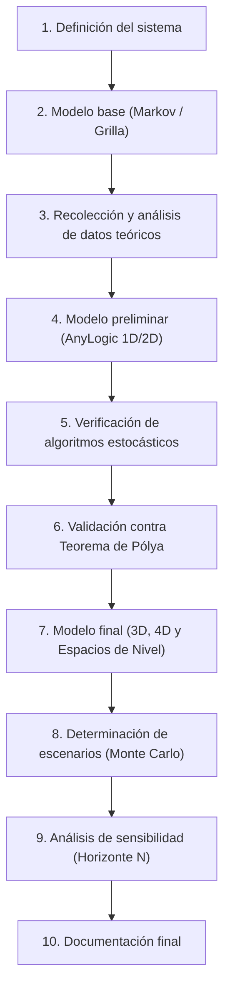

# Trabajo Práctico de Simulación Matemática - UTN
## Proyecto: Caminatas Aleatorias Multidimensionales (1D a 4D), Teorema de Pólya y Espacios de Nivel en AnyLogic

---

## 1. Explicación y Fundamentación del Proyecto

### 1.1. Contexto Matemático: Cadenas de Markov y Teorema de Pólya
Una **Caminata Aleatoria Simple (Simple Random Walk)** en la red discreta $\mathbb{Z}^d$ es un proceso estocástico en tiempo discreto $\{X_n\}_{n \ge 0}$ modelado como una **Cadena de Markov**. En cada paso temporal, la partícula salta a uno de sus $2d$ vecinos más cercanos con idéntica probabilidad $p = \frac{1}{2d}$.

En 1921, el matemático George Pólya formuló uno de los teoremas más célebres de la teoría de probabilidades:
> *"Un borracho que camina al azar siempre encontrará el camino de regreso a casa (en 1 y 2 dimensiones); pero un pájaro borracho que vuela al azar en 3 dimensiones puede perderse para siempre."*

Formalmente, si definimos la **probabilidad de retorno al origen** como:
$$P_{ret} = P(\exists \, n \ge 1 \text{ tal que } X_n = 0 \mid X_0 = 0)$$

Los valores teóricos demostrados analíticamente mediante integrales de Watson y funciones generatrices son:

| Dimensión ($d$) | Naturaleza del Estado | Probabilidad Teórica de Retorno ($P_{ret}$) | Tiempo Medio de Retorno ($\mathbb{E}[T]$) |
| :---: | :---: | :---: | :---: |
| **1D** ($\mathbb{Z}^1$) | **Recurrente nula** | **$1.0000$ ($100\%$)** | $\infty$ (diverge) |
| **2D** ($\mathbb{Z}^2$) | **Recurrente nula** | **$1.0000$ ($100\%$)** | $\infty$ (diverge) |
| **3D** ($\mathbb{Z}^3$) | **Transiente** | $\approx \mathbf{0.340537}$ ($\approx 34.05\%$) | No aplicable ($P < 1$) |
| **4D** ($\mathbb{Z}^4$) | **Transiente** | $\approx \mathbf{0.193201}$ ($\approx 19.32\%$) | No aplicable ($P < 1$) |

A medida que aumenta la dimensión $d$, el espacio disponible crece exponencialmente ($2d$ direcciones), lo que hace cada vez más improbable que la trayectoria estocástica vuelva a intersectar el origen.

---

### 1.2. El Reto de las 4 Dimensiones: Espacios de Nivel (Slices / Foliación)
En AnyLogic podemos visualizar 2D y 3D directamente, pero ¿cómo abordamos la cuarta dimensión espacial $w$ para que sea interpretable tanto visual como matemáticamente?

El vector de posición en 4D es:
$$\vec{X}_n = (x_n, y_n, z_n, w_n) \in \mathbb{Z}^4$$

En cada paso, el caminante elige aleatoriamente entre 8 opciones equiprobables:
$$\Delta \vec{X} \in \{ (\pm 1, 0, 0, 0), (0, \pm 1, 0, 0), (0, 0, \pm 1, 0), (0, 0, 0, \pm 1) \}$$

Para visualizar y analizar 4D utilizamos la técnica de **Espacios de Nivel (Hiperplanos / Slices fijando $w$)**:
1. **Intersección con el hiperplano central $w = 0$:** La partícula solo puede retornar al origen cuatridimensional $(0,0,0,0)$ si simultáneamente se encuentra en el espacio de nivel $w=0$ y sus coordenadas tridimensionales son $(0,0,0)$.
2. **Visualización 3D coloreada por la 4ta coordenada:** Representamos el camino en la ventana 3D de AnyLogic $(x, y, z)$, y mapeamos la coordenada $w$ al color de la trayectoria o de la esfera (ej: $w=0$ blanco brillante; $w > 0$ tonos cálidos; $w < 0$ tonos fríos).
3. **Múltiples vistas por capas de nivel:** Paneles o gráficos dedicados que muestran cuándo el caminante entra y sale del nivel $w=0$, midiendo los "tiempos entre visitas al hiperplano" y comparándolos con el tiempo de retorno exacto a $(0,0,0,0)$.

---

## 2. Desarrollo de la Simulación en AnyLogic según los 10 Pasos



---

### Paso 1: Definición del Sistema Bajo Estudio

* **Objetivo General:** Evaluar computacionalmente mediante simulación Monte Carlo en AnyLogic la probabilidad de retorno al origen $P_{ret}(N)$ y la distribución del tiempo del primer retorno $T_{ret}$ en caminatas aleatorias simples sobre redes $\mathbb{Z}^d$ para $d \in \{1, 2, 3, 4\}$.
* **Límites del Sistema:**
  - Red regular no acotada (teóricamente infinita) o con frontera absorbente/reflectante situada a distancia suficiente para no truncar la caminata dentro del horizonte $N$.
* **Entidades y Atributos:**
  - **Agente `Walker` (Caminante):** Coordenadas $(x, y, z, w)$, contador de pasos $n$, booleano `hasReturned`, tiempo de primer retorno $T_{ret}$, trayectoria histórica.
  - **Controlador `Main`:** Dimensión activa $d$, horizonte máximo de pasos $N_{max}$, número de réplicas independientes $M$, acumulador de retornos exitosos.
* **Variables del Sistema:**
  - *Variables de Entrada:* Dimensión $d \in \{1, 2, 3, 4\}$, número de réplicas $M$, horizonte de pasos $N$ (ej. $10^2, 10^3, 10^4, 10^5$).
  - *Variables de Estado:* $(\vec{X}_n, n)$ de cada caminante activo.
  - *Variables de Salida:*
    - Probabilidad empírica de retorno en hasta $N$ pasos: $\hat{P}_{ret}(N) = \frac{\text{Caminantes que volvieron}}{M}$.
    - Histograma del tiempo del primer retorno $T_{ret}$.
    - Tasa de visita y permanencia en el espacio de nivel $w=0$.
* **Hipótesis del Modelo:**
  - Saltos homogéneos e isotrópicos: idéntica probabilidad en todas las direcciones permitidas.
  - Pasos mutuamente independientes (ausencia de memoria / propiedad de Markov).

---

### Paso 2: Generación del Modelo de Simulación Base (Conceptual)

* **Cadena de Markov Subyacente:**
  - Espacio de estados discreto: $S = \mathbb{Z}^d$.
  - Matriz de transición $P$:
    $$P_{\vec{u}, \vec{v}} = \begin{cases} \frac{1}{2d} & \text{si } \|\vec{u} - \vec{v}\|_1 = 1 \\ 0 & \text{en otro caso} \end{cases}$$
* **Primer Tiempo de Retorno (Stopping Time):**
  - Se define $T = \inf \{ n \ge 1 : \vec{X}_n = \vec{0} \}$.
  - Si el caminante vuelve en el paso $k \le N$, se detiene la trayectoria de esa réplica o se computa el evento de retorno y se registra $T = k$.
  - Si al llegar a $N$ nunca volvió a $\vec{0}$, se registra retorno no observado en el horizonte $N$ ($T > N$).
* **Foliación en 4D (Espacio de Nivel $w=k$):**
  - Descomposición de la trayectoria en una proyección 3D $\vec{Y}_n = (x_n, y_n, z_n)$ y un proceso marginal 1D $w_n$.
  - Nótese que $w_n$ por sí solo es un paseo aleatorio 1D que se mueve con probabilidad $1/4$ hacia $+1$, $1/4$ hacia $-1$, y se queda quieto con probabilidad $1/2$ (cuando el salto ocurre en $x, y$ o $z$). Por tanto, $w_n$ vuelve infinitas veces a $0$, pero la vuelta a $(0,0,0,0)$ exige que coincida con el retorno de $(x,y,z)$ a $(0,0,0)$.

---

### Paso 3: Recolección y Análisis de Datos (Valores Teóricos de Referencia)

Para contrastar la simulación, se documentan las soluciones analíticas exactas de la literatura:

1. **Probabilidad de estar en el origen en el paso $2n$ ($P(\vec{X}_{2n} = \vec{0})$):**
   - En 1D: $u_{2n}^{(1)} = \binom{2n}{n} \left(\frac{1}{2}\right)^{2n} \sim \frac{1}{\sqrt{\pi n}}$. Como $\sum u_{2n} = \infty$, el estado es recurrente.
   - En 2D: $u_{2n}^{(2)} = \left[ \binom{2n}{n} \left(\frac{1}{2}\right)^{2n} \right]^2 \sim \frac{1}{\pi n}$. Como $\sum \frac{1}{n} = \infty$, es recurrente.
   - En 3D: $u_{2n}^{(3)} \sim \frac{C_3}{n^{3/2}}$. Como $\sum n^{-3/2} < \infty$, el estado es **transiente**.
   - En 4D: $u_{2n}^{(4)} \sim \frac{C_4}{n^2}$. Como $\sum n^{-2} < \infty$, es **transiente**.

2. **Probabilidad asintótica de retorno al origen ($N \to \infty$):**
   - **$d = 1$:** $P_{ret} = 1.0000$ ($100\%$).
   - **$d = 2$:** $P_{ret} = 1.0000$ ($100\%$).
   - **$d = 3$:** $P_{ret} = 1 - \frac{1}{u_3} \approx 0.34053733$.
   - **$d = 4$:** $P_{ret} = 1 - \frac{1}{u_4} \approx 0.19320167$.

3. **Probabilidad finita de retorno en $N$ pasos ($P(T \le N)$):**
   - En dimensiones recurrentes (1D y 2D), aunque $P_{ret} = 1$ para $N \to \infty$, la convergencia es lenta:
     - En 1D: $P(T \le N) = 1 - \frac{1}{\sqrt{\pi N}} + O(N^{-3/2})$. Para $N = 10\,000$, $P \approx 98.87\%$.
     - En 2D: $P(T \le N) \sim 1 - \frac{\pi}{\ln N}$. Converge de forma logarítmica (muy lenta: para $N=1000$ aún ronda el $70\%$).
   - En 3D y 4D, $P(T \le N)$ se satura muy rápidamente cerca de sus asíntotas ($34\%$ y $19\%$).

---

### Paso 4: Generación de Modelo Preliminar en AnyLogic

* **Arquitectura de Agentes en AnyLogic:**
  1. **Agente `Walker`:**
     - Parámetros: `id`, `dimension` (1, 2, 3 o 4).
     - Variables: `int x`, `int y`, `int z`, `int w`, `int steps`, `boolean returned`, `int returnTime`.
     - Funciones:
       - `step()`: Genera un número entero aleatorio uniforme en $[0, 2d - 1]$ y traslada las coordenadas correspondientes.
       - `checkOrigin()`: Evalúa si $(x == 0 \text{ && } y == 0 \text{ && } (d < 3 \text{ || } z == 0) \text{ && } (d < 4 \text{ || } w == 0))$.
  2. **Agente `Main`:**
     - Colección de agentes `walkers` o ejecución secuencial batch/Monte Carlo para procesar miles de réplicas sin saturar la memoria gráfica.
     - Gráficos de salida preliminares:
       - Visualización 2D/3D del rastro de un caminante de muestra.
       - Gráfico de barras / indicador digital con el porcentaje de retornos observados hasta el momento.

---

### Paso 5: Verificación del Modelo

* **Objetivo:** Garantizar que el generador estocástico y la lógica dimensional estén libres de errores de implementación.
* **Pruebas de Verificación:**
  1. **Prueba de Isotropía y Esperanza Nula:**
     - Tras $N$ pasos, la posición media de $M$ caminantes debe ser estadísticamente indistinguible de cero:
       $$\mathbb{E}[\vec{X}_N] \approx \vec{0}$$
  2. **Prueba de Difusión / Varianza ($\mathbb{E}[\|\vec{X}_N\|^2] = N$):**
     - En una caminata simple no acotada, la distancia cuadrática media al origen tras $N$ pasos debe cumplir:
       $$\mathbb{E}[R^2(N)] = \mathbb{E}[x_N^2 + y_N^2 + z_N^2 + w_N^2] = N$$
     - Si la varianza crece linealmente con pendiente $1.00$, la mecánica de saltos está matemáticamente verificada.
  3. **Prueba de Paridad:**
     - En cualquier dimensión sobre una red bipartita, el caminante **sólo puede regresar al origen en pasos pares** ($n = 2, 4, 6, \dots$). El retorno en un paso impar debe ser estrictamente imposible ($P(T = 2k+1) = 0$).

---

### Paso 6: Validación del Modelo

* **Objetivo:** Comprobar si los porcentajes de retorno experimentales coinciden con los valores teóricos del Teorema de Pólya.
* **Metodología de Validación:**
  1. **Estimador de Monte Carlo:**
     - Correr $M = 50\,000$ réplicas independientes para cada dimensión con horizonte $N = 10\,000$.
     - Calcular el intervalo de confianza del $95\%$ para la proporción muestral $\hat{p}$:
       $$\hat{p} \pm 1.96 \sqrt{\frac{\hat{p}(1-\hat{p})}{M}}$$
  2. **Contraste con los valores de Pólya:**
     - Para 3D: Contrastar si $0.3405$ se encuentra dentro del intervalo de confianza empírico.
     - Para 4D: Contrastar si $0.1932$ cae dentro del intervalo de confianza empírico.
     - Test de Hipótesis $Z$ para una proporción:
       $$Z = \frac{\hat{p} - p_{\text{teórico}}}{\sqrt{\frac{p_{\text{teórico}}(1 - p_{\text{teórico}})}{M}}}$$
     - Si $|Z| < 1.96$, el modelo está validado con significancia del $5\%$.

---

### Paso 7: Generación del Modelo Final (UI, 4D y Espacios de Nivel)

* **Innovación en AnyLogic: Representación de 4D mediante Espacios de Nivel:**
  1. **Visualizador 3D con Gradiente Cuatridimensional:**
     - La escena 3D renderiza $(x, y, z)$.
     - El color de la esfera o del rastro representa el valor de la 4ta coordenada $w$:
       - $w = 0$: **Blanco resplandeciente / Dorado** (indica que el caminante está en el hiperplano del origen).
       - $w > 0$: Gradiente de **Rojos y Naranjas** (niveles superiores).
       - $w < 0$: Gradiente de **Azules y Violetas** (niveles inferiores).
  2. **Instrumentación del Espacio de Nivel $w = 0$:**
     - Monitor secundario: Gráfico temporal que muestra $w(t)$ como una onda que cruza la línea cero.
     - Se registra cuántas veces el caminante "atraviesa" el nivel $w=0$ sin haber retornado al origen completo $(0,0,0,0)$, demostrando por qué la 4ta dimensión disminuye la probabilidad de retorno global.
  3. **Panel de Experimentación y Controles:**
     - Selector de Dimensión: Botones radiales (1D, 2D, 3D, 4D).
     - Slider de Pasos Máximos ($N$ de $100$ a $50\,000$).
     - Slider de Cantidad de Corridas ($M$ de $500$ a $20\,000$).
     - Curva en tiempo real: Probabilidad acumulada de retorno $\hat{P}(n)$ en función del número de pasos $n \le N$.

---

### Paso 8: Determinación de los Escenarios para el Análisis

Se definen 4 escenarios experimentales formales para el trabajo:

* **Escenario 1: Comparación Dimensional Directa (1D vs 2D vs 3D vs 4D):**
  - Mismo horizonte ($N = 10\,000$) y $M = 10\,000$ réplicas para todas las dimensiones.
  - Medir $\hat{P}_{ret}$ y graficar las curvas acumuladas $P(T \le n)$ vs $n$ superpuestas para evidenciar la transición de recurrencia a transiencia.
* **Escenario 2: Análisis del Espacio de Nivel en 4D ($w = 0$ vs $w \neq 0$):**
  - Registrar el número de visitas al hiperplano $w=0$ antes de regresar a $(0,0,0,0)$ o antes de alcanzar $N$.
  - Comparar la probabilidad condicional:
    $$P(\text{retorno a } \vec{0} \mid \text{visita el nivel } w=0)$$
* **Escenario 3: Tiempo de Retorno Condicional ($T_{ret} \mid \text{volvió}$):**
  - Para los caminantes que efectivamente regresan en 3D y 4D, analizar el histograma de $T_{ret}$.
  - Demostrar que si una partícula en 3D o 4D va a volver, **tiende a hacerlo muy rápido** (en los primeros $20$ a $50$ pasos); si se aleja de la vecindad inmediata, la probabilidad de escape tiende rápidamente a $1$.
* **Escenario 4: Caminata Sesgada / Asimétrica (Markov con Drift):**
  - Introducir una pequeña probabilidad de deriva $p_{deriva} > 0$ en una dirección (ej. viento o campo eléctrico).
  - Evaluar cómo se destruye la recurrencia incluso en 1D y 2D, colapsando la probabilidad de retorno.

---

### Paso 9: Análisis de Sensibilidad

* **Sensibilidad al Horizonte de Pasos $N$ ($N = 100, 500, 1000, 5000, 20000$):**
  - En 1D y 2D, la probabilidad observada $\hat{P}$ crece notablemente con $N$ (búsqueda de la asíntota $1.0$).
  - En 3D y 4D, la probabilidad se estabiliza rápidamente (plateau) alrededor de $0.34$ y $0.19$, demostrando que aumentar $N$ más allá de $5\,000$ apenas incrementa los retornos adicionales.
* **Sensibilidad al Tamaño de Muestra de Réplicas $M$ ($M = 100, 1000, 10000, 50000$):**
  - Análisis del error estándar del estimador: $\sigma_{\hat{p}} \propto \frac{1}{\sqrt{M}}$.
  - Determinar el $M$ óptimo que balancea tiempo de cómputo en AnyLogic con precisión de 3 decimales.

---

### Paso 10: Documentación Final y Conclusiones

* **Estructura del Informe de Cátedra:**
  1. Portada formal y miembros del equipo.
  2. Introducción teórica: Cadenas de Markov, caminatas en retículos, formulación de George Pólya (1921) e integrales de Watson.
  3. Formalización conceptual y diagrama de agentes AnyLogic.
  4. La 4ta dimensión: Metodología de Espacios de Nivel y foliación $w=k$.
  5. Protocolo de Verificación (isotropía, varianza $\mathbb{E}[R^2]=N$, paridad estricta).
  6. Resultados de Validación: Tablas con estimaciones de Monte Carlo, intervalos de confianza del $95\%$ y comparación contra los valores teóricos ($1.0, 1.0, 0.3405, 0.1932$).
  7. Conclusiones sobre la naturaleza de la transiencia y cómo la dimensionalidad transforma la topología de los caminos aleatorios.
  8. Manual de usuario del modelo AnyLogic y código fuente comentado.

---

## 3. Código Java Clave para Implementar en AnyLogic

### 3.1. Algoritmo de Salto Cuatridimensional (Agente `Walker`)
```java
// Método step4D() dentro del agente Walker
int dir = uniform_discr(0, 7); // 8 direcciones posibles en 4D

switch(dir) {
    case 0: x++; break;
    case 1: x--; break;
    case 2: y++; break;
    case 3: y--; break;
    case 4: z++; break;
    case 5: z--; break;
    case 6: w++; break;
    case 7: w--; break;
}
steps++;

// Verificación de retorno al origen completo (0,0,0,0)
if (x == 0 && y == 0 && z == 0 && w == 0) {
    returned = true;
    returnTime = steps;
}
```

### 3.2. Coloreo en Espacios de Nivel para Visualización 3D
```java
// Función getColorForLevel() dentro de Walker para la visualización en la ventana 3D
if (w == 0) {
    return Color.WHITE; // Está en el espacio de nivel del origen
} else if (w > 0) {
    // Niveles positivos: gradiente hacia amarillo/rojo
    int intensity = Math.min(255, 50 + w * 40);
    return new Color(255, 255 - intensity / 2, 0);
} else {
    // Niveles negativos: gradiente hacia cian/azul
    int intensity = Math.min(255, 50 + Math.abs(w) * 40);
    return new Color(0, 255 - intensity / 2, 255);
}
```

### 3.3. Experimento Monte Carlo en `Simulation` (AnyLogic Java)
```java
// En un botón o evento para ejecutar M simulaciones rápidas sin lag de animación
int M = 20000;       // Número de réplicas
int N_max = 5000;    // Horizonte de pasos
int returnsCount = 0;

for (int rep = 0; rep < M; rep++) {
    int x = 0, y = 0, z = 0, w = 0;
    boolean returned = false;

    for (int s = 1; s <= N_max; s++) {
        int dir = uniform_discr(0, 7);
        if (dir == 0) x++; else if (dir == 1) x--;
        else if (dir == 2) y++; else if (dir == 3) y--;
        else if (dir == 4) z++; else if (dir == 5) z--;
        else if (dir == 6) w++; else if (dir == 7) w--;

        // Solo puede volver en pasos pares
        if ((s % 2 == 0) && x == 0 && y == 0 && z == 0 && w == 0) {
            returned = true;
            break;
        }
    }
    if (returned) returnsCount++;
}

double pEmpirica = (double) returnsCount / M;
traceln("Probabilidad empírica de retorno en 4D (N=" + N_max + "): " + pEmpirica);
traceln("Valor teórico esperado de Pólya: 0.1932");
```
