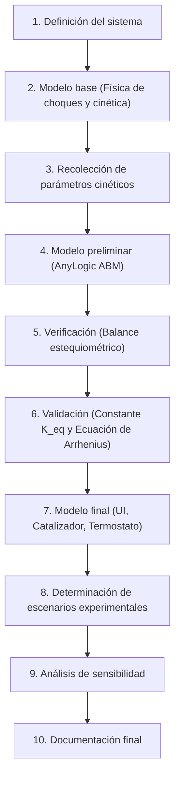

# Trabajo Práctico Integrador de Simulación - UTN

## Proyecto: Simulación Híbrida de Cinética de Reacciones Químicas, Equilibrio y Ley de Arrhenius en AnyLogic

---

## 1. Explicación Integral del Proyecto (Fundamentos Químicos y de Simulación)

### 1.1. Introducción para No Especialistas en Química

Una **reacción química** es un proceso en el cual una o más sustancias (llamadas **reactivos**) chocan e interactúan con la suficiente energía y orientación espacial adecuada para romper sus enlaces y reorganizarse en sustancias diferentes (llamadas **productos**).

La **Cinética Química** es la rama de la química física que estudia **la velocidad a la que ocurren las reacciones** y los mecanismos moleculares que explican dicha velocidad.

Existen 5 factores clave que determinan la velocidad de una reacción química:

1. **Concentración de los reactivos:** Cuantas más moléculas haya por unidad de volumen, mayor es la frecuencia de choques por segundo.
2. **Temperatura del reactor:** A mayor temperatura, las moléculas viajan a mayor velocidad (mayor energía cinética). Esto aumenta tanto la cantidad de choques por segundo como la fracción de choques que superan la barrera energética.
3. **Energía de Activación ($E_a$):** Es la energía mínima indispensable que deben tener las moléculas en el momento del impacto para que los enlaces se rompan y la reacción tenga éxito.
4. **Presencia de un Catalizador:** Es una sustancia que disminuye la Energía de Activación necesaria, acelerando la reacción sin consumirse en el proceso.
5. **Reversibilidad y Equilibrio Químico:** Muchas reacciones no van al 100% en un solo sentido. A medida que se acumulan los productos, estos también chocan entre sí y se regeneran los reactivos originales hasta alcanzar un estado de **equilibrio dinámico**.

---

### 1.2. El Sistema Químico Seleccionado para la Simulación

Para que el proyecto seleccionamos una **reacción bimolecular reversible de segundo orden**:

$$A + B \underset{k_2}{\overset{k_1}{\rightleftharpoons}} C$$

* **Reactivo $A$ (ej. Molécula Azul):** Sustancia reactiva inicial.
* **Reactivo $B$ (ej. Molécula Amarilla):** Segunda sustancia reactiva inicial.
* **Producto $C$ (ej. Molécula Verde o Roja):** Compuesto resultante de la unión de $A$ y $B$.
* **Reacción Directa ($A + B \xrightarrow{k_1} C$):** Ocurre cuando una molécula $A$ choca contra una molécula $B$ y la energía cinética relativa del choque supera la energía de activación directa $E_{a,1}$.
* **Reacción Inversa ($C \xrightarrow{k_2} A + B$):** La molécula $C$ puede descomponerse espontáneamente tras un tiempo de vida estocástico (o por colisión con suficiente energía $E_{a,2}$), regenerando una molécula $A$ y una molécula $B$.

---

### 1.3. Las Ecuaciones Matemáticas del Fenómeno

#### A. Ley de Acción de Masas (Macroscópica - Guldberg & Waage)

A nivel macroscópico, la velocidad de cambio de las concentraciones molares se expresa mediante un sistema de Ecuaciones Diferenciales Ordinarias (EDO):

$$\frac{d[A]}{dt} = -k_1 [A][B] + k_2 [C]$$
$$\frac{d[B]}{dt} = -k_1 [A][B] + k_2 [C]$$
$$\frac{d[C]}{dt} = +k_1 [A][B] - k_2 [C]$$

En el **equilibrio químico** ($\frac{d[C]}{dt} = 0$), las velocidades directa e inversa se igualan:
$$k_1 [A]_{eq}[B]_{eq} = k_2 [C]_{eq} \implies K_{eq} = \frac{[C]_{eq}}{[A]_{eq}[B]_{eq}} = \frac{k_1}{k_2}$$
Donde $K_{eq}$ es la **Constante de Equilibrio Termodinámico**.

#### B. La Ecuación de Svante Arrhenius (Dependencia con la Temperatura)

La constante cinética $k$ depende exponencialmente de la temperatura absoluta $T$ (en Kelvin):

$$k(T) = \mathcal{A} \cdot \exp\left(-\frac{E_a}{R \cdot T}\right)$$

Donde:

* $\mathcal{A}$: Factor pre-exponencial de frecuencia (frecuencia de colisiones con orientación geométrica correcta).
* $E_a$: Energía de activación de la reacción ($\text{J/mol}$).
* $R$: Constante universal de los gases ($8.314 \text{ J/(mol}\cdot\text{K)}$).
* $T$: Temperatura absoluta ($\text{K}$).

---

### 1.4. ¿Por qué AnyLogic es la Plataforma Ideal para este Trabajo?

AnyLogic permite una arquitectura **Híbrida Multiparadigma**:

1. **Nivel Microscópico (Basado en Agentes - ABM):**
   Las moléculas $A$, $B$ y $C$ son agentes individuales que rebotan en una cámara 2D o 3D. Al chocar, evalúan probabilísticamente la regla de Arrhenius. Se ven físicamente los choques, cambios de color y fluctuaciones moleculares (algoritmo estocástico tipo Gillespie).
2. **Nivel Macroscópico (Dinámica de Sistemas - SD):**
   En la misma pantalla, se puede colocar un diagrama de Stocks & Flows que resuelve en paralelo las ecuaciones diferenciales teóricas de la Ley de Acción de Masas.
3. **Contraste Visual Único:**
   Los gráficos de AnyLogic permiten superponer la **curva teórica suave (SD)** con la **curva estocástica real con ruido térmico (ABM)**, demostrando cómo la ley macroscópica emerge de los choques moleculares individuales (Ley de los Grandes Números).

---

## 2. Desarrollo Paso a Paso Según la Metodología de Simulación



---

### Paso 1: Definición del Sistema Bajo Estudio

* **Objetivo del Estudio:** Modelar y analizar la cinética de una reacción química reversible $A + B \rightleftharpoons C$, evaluando el impacto de la concentración inicial, la temperatura del reactor y la adición de catalizadores sobre la velocidad de reacción y la posición del equilibrio químico.
* **Límites del Sistema:**
  - Reactor químico de volumen cerrado y constante $V$ (recinto 2D de dimensiones $L_x \times L_y$ en AnyLogic).
  - Paredes no reactivas que mantienen confinadas a las moléculas.
  - Termostato que controla la temperatura interna del medio $T$.
* **Entidades y Atributos:**
  - **Agente `Molecule`:** Coordenadas $(x, y)$, componentes de velocidad $(vx, vy)$, tipo molecular (`Type`: `A`, `B`, o `C`), masa $m$, radio $r$, energía cinética instantánea $E_k = \frac{1}{2} m (vx^2 + vy^2)$, tiempo de formación.
  - **Entorno `Main`:** Temperatura $T$, energía de activación directa $E_{a,1}$, energía de activación inversa $E_{a,2}$, estado del catalizador (activo/inactivo), contadores de población $N_A(t)$, $N_B(t)$, $N_C(t)$.
* **Variables del Sistema:**
  - *Variables de Entrada (Controlables):* Concentraciones iniciales $N_{A,0}, N_{B,0}, N_{C,0}$, Temperatura $T$, Energía de Activación $E_a$, factor catalizador.
  - *Variables de Estado:* Tipo y coordenadas de cada molécula en cada paso de tiempo.
  - *Variables de Salida:* Perfil temporal de concentraciones $[A](t), [B](t), [C](t)$, tiempo necesario para alcanzar el $50\%$ de avance ($t_{1/2}$ o tiempo de vida media), tiempo para alcanzar el equilibrio $t_{eq}$, valor empírico de la constante de equilibrio $\hat{K}_{eq}$.
* **Hipótesis Simplificativas:**
  - Las moléculas se modelan como esferas rígidas.
  - Los choques entre especies idénticas ($A-A$, $B-B$, $C-C$) o no reactivas ($A-C$, $B-C$) son colisiones elásticas puras.
  - El choque $A-B$ tiene probabilidad de reaccionar si la energía cinética en el centro de masa supera $E_a$.

---

### Paso 2: Generación del Modelo de Simulación Base (Conceptual)

* **Mecánica de Movimiento y Termalización:**
  - Las partículas se mueven a velocidad térmica proporcional a $\sqrt{T}$ siguiendo la distribución de Maxwell:
    $$\langle v \rangle = \sqrt{\frac{8 k_B T}{\pi m}}$$
* **Criterio de Reacción por Colisión (Teoría de Choques):**
  - Cuando dos moléculas $i \in A$ y $j \in B$ colisionan (distancia euclídea $\le r_A + r_B$):
    1. Se calcula la energía cinética relativa a lo largo de la línea normal de choque:
       $$E_{rel} = \frac{1}{2} \mu (\vec{v}_{rel} \cdot \hat{n})^2$$
       donde $\mu = \frac{m_A m_B}{m_A + m_B}$ es la masa reducida.
    2. **Condición de reacción:** Si $E_{rel} \ge E_{a,1}$ (o con probabilidad probabilística de Arrhenius $P = \exp(-E_{a,1} / k_B T)$):
       - Se destruyen $A$ y $B$ (o se transforma $A$ en $C$ y se remueve $B$).
       - La nueva molécula $C$ adopta la posición del centro de masa y conserva la cantidad de movimiento:
         $$\vec{v}_C = \frac{m_A \vec{v}_A + m_B \vec{v}_B}{m_A + m_B}$$
       - Se libera o absorbe calor según la entalpía de reacción $\Delta H = E_{a,1} - E_{a,2}$.
    3. Si $E_{rel} < E_{a,1}$, rebotan elásticamente como esferas ordinarias.
* **Mecánica de la Reacción Inversa ($C \xrightarrow{k_2} A + B$):**
  - Cada molécula $C$ tiene una tasa de decaimiento estocástica proporcional a $k_2(T) = \mathcal{A}_2 \exp(-E_{a,2} / k_B T)$.
  - En cada intervalo $dt$, la probabilidad de descomposición es:
    $$P_{desc} = 1 - \exp(-k_2 \cdot dt)$$
  - Al descomponerse, $C$ se disocia en una molécula $A$ y una $B$ que se eyectan en direcciones opuestas con energía liberada.

---

### Paso 3: Recolección y Análisis de Datos (Parámetros y Calibración)

* **Escala de Simulación Normalizada:**
  - Para operar en AnyLogic sin lidiar con números de moléculas del orden de Avogadro ($6.022 \times 10^{23}$) ni constantes $k_B \approx 10^{-23}$, se emplean unidades reducidas:
    - Constante de Boltzmann efectiva: $k_B = 1.0$.
    - Rango de Temperatura de trabajo: $T \in [50, 500]$ unidades arbitrarias.
    - Energía de Activación directa: $E_{a,1} = 100.0$.
    - Energía de Activación inversa: $E_{a,2} = 150.0$ (Reacción Exotérmica: $\Delta H = -50$).
* **Curvas Teóricas para Validación:**
  - Resolver analítica y numéricamente el sistema de EDOs macroscópico con método Runge-Kutta para disponer de los valores esperados de $[A](t), [B](t), [C](t)$ en cada segundo de simulación.

---

### Paso 4: Generación de Modelo Preliminar en AnyLogic

* **Estructura en AnyLogic:**
  1. **Agente `Molecule`:**
     - Parámetros: `int type` (0 para A, 1 para B, 2 para C).
     - Variables: `double vx, vy, x, y`, `Color myColor`.
     - Forma gráfica: Círculo con radio 4 (A), 4 (B), 6 (C).
     - Asignación de color: Azul para A, Amarillo para B, Verde para C.
     - Función `step()` para avance de posición y rebote contra paredes.
  2. **Agente `Main`:**
     - Población `molecules` con $N_{A,0} = 150$, $N_{B,0} = 150$, $N_{C,0} = 0$.
     - Evento cíclico `stepEvent` (tasa $0.02$ seg) que detecta colisiones entre moléculas y aplica la lógica reactiva.
     - Gráfico de series de tiempo (`Time Plot`) con 3 curvas en vivo:
       - Azul: Cantidad de partículas de $A$.
       - Amarillo: Cantidad de partículas de $B$.
       - Verde: Cantidad de partículas de $C$.

---

### Paso 5: Verificación del Modelo

* **Objetivo:** Asegurar que el motor computacional respeta las leyes de conservación y la estequiometría química.
* **Pruebas de Verificación:**
  1. **Conservación de la Masa / Balance de Átomos:**
     - Dado que 1 molécula de $A$ + 1 molécula de $B$ generan 1 molécula de $C$:
       $$N_A(t) + N_C(t) = N_{A,0} = \text{Constante}$$
       $$N_B(t) + N_C(t) = N_{B,0} = \text{Constante}$$
     - Si la suma total de átomos no es exactamente constante en todo $t$, existe un bug de creación o duplicación indebida de agentes.
  2. **Conservación del Momento Lineal Total:**
     - El centro de masa de la cámara no debe presentar aceleración espuria tras las reacciones o choques.
  3. **Ausencia de Reacción en Frío Absoluto ($T \to 0$):**
     - Si se fija $T = 1$, las partículas no tienen energía suficiente para superar $E_a$; la cantidad de $C$ debe permanecer estrictamente en 0.

---

### Paso 6: Validación del Modelo

* **Objetivo:** Demostrar que el comportamiento estocástico del modelo converge cuantitativamente a las leyes fundamentales de la química física.
* **Pruebas de Validación:**
  1. **Validación de la Constante de Equilibrio ($K_{eq}$):**
     - Dejar correr la simulación hasta alcanzar el estado estacionario ($t > t_{eq}$).
     - Calcular el cociente de concentraciones medio en equilibrio:
       $$\hat{K}_{eq} = \frac{\langle N_C \rangle_{eq}}{\langle N_A \rangle_{eq} \cdot \langle N_B \rangle_{eq}}$$
     - Repetir para 10 corridas y verificar mediante un Test $t$ de Student que $\hat{K}_{eq}$ no difiere significativamente del valor teórico $K_{eq}(T) = \exp(-\Delta G^\circ / RT)$.
  2. **Validación de la Ley de Arrhenius ($\ln(k)$ vs $1/T$):**
     - Medir la velocidad inicial de reacción $v_0 = \left. \frac{\Delta N_C}{\Delta t} \right|_{t=0}$ a 5 temperaturas distintas ($T = 100, 150, 200, 250, 300$).
     - Estimar $k_1(T) = \frac{v_0}{N_A(0) N_B(0)}$.
     - Construir el gráfico de Arrhenius: $\ln(k_1)$ en función de $\frac{1}{T}$.
     - Comprobar que los puntos experimentales ajustan a una recta ($R^2 > 0.98$) cuya pendiente sea $-\frac{E_a}{k_B}$.

---

### Paso 7: Generación del Modelo Final (UI, Catalizador y Controles)

* **Elementos de la Interfaz Interactiva en AnyLogic:**
  1. **Controles de Parámetros en Tiempo Real:**
     - **Slider de Temperatura ($T$):** Permite subir la temperatura para ver cómo se aceleran las moléculas y la reacción se desplaza según el principio de Le Chatelier.
     - **Botón "Añadir Catalizador":** Reduce instantáneamente la energía de activación directa $E_{a,1}$ en un $60\%$, mostrando visualmente el disparo en la tasa de formación de $C$.
     - **Botones de Inyección:** "Inyectar $+50$ moléculas de A", "Inyectar $+50$ moléculas de B", permitiendo perturbar el equilibrio.
  2. **Panel Visual de Monitoreo:**
     - Animación central del reactor: Esferas azules ($A$), amarillas ($B$) y verdes ($C$) moviéndose en tiempo real.
     - **Gráfico Comparativo Híbrido:** Curvas empíricas de agentes (con ruido molecular) superpuestas con las curvas teóricas deterministas de Dinámica de Sistemas.
     - Tacómetros digitales de:
       - Velocidad de reacción instantánea ($r_A, r_C$).
       - Porcentaje de conversión de reactivos: $\% \text{Conversión} = \frac{N_{A,0} - N_A(t)}{N_{A,0}} \times 100\%$.

---

### Paso 8: Determinación de Escenarios para el Análisis

Se definen 4 escenarios de alto valor formativo y analítico:

* **Escenario 1: Efecto de la Temperatura y Comprobación de Arrhenius:**
  - Evaluar la reacción a $T = 100\text{ K}$ (lenta), $T = 200\text{ K}$ (moderada) y $T = 400\text{ K}$ (ultrarrápida).
  - Medir el tiempo de vida media $t_{1/2}$ en cada caso.
* **Escenario 2: Cinética con Reactivo Limitante:**
  - Iniciar con $N_A = 200$ y $N_B = 50$ (reactivo $B$ limitante).
  - Demostrar que la formación de $C$ se detiene cuando $B$ se agota, dejando un excedente de $A$ inalterado.
* **Escenario 3: Efecto de un Catalizador:**
  - Iniciar la reacción a temperatura moderada sin catalizador hasta observar velocidad lenta.
  - A los $t = 50$ segundos, activar el catalizador. Documentar el cambio brusco de pendiente en la curva de producción de $C$.
* **Escenario 4: Demostración del Principio de Le Chatelier:**
  - Una vez alcanzado el equilibrio químico estable ($A + B \rightleftharpoons C$):
    - Perturbación 1: Inyectar un pulso masivo de $A$. Observar cómo el sistema reacciona consumiendo $B$ y produciendo más $C$.
    - Perturbación 2: Enfriar bruscamente el reactor. Observar el desplazamiento hacia el lado exotérmico.

---

### Paso 9: Análisis de Sensibilidad

* **Sensibilidad a la Energía de Activación $E_a$:**
  - Variar $E_a$ entre $50$ y $250$. Demostrar la extrema sensibilidad exponencial (un pequeño incremento en $E_a$ congela la velocidad de reacción).
* **Sensibilidad al Volumen del Reactor $V$ (Efecto de Presión/Densidad):**
  - Reducir el tamaño de la caja a la mitad manteniendo $N$ constante (duplicando la concentración).
  - Verificar que la velocidad de una reacción de segundo orden se cuadruplica ($v \propto [A][B] \propto \frac{1}{V^2}$).
* **Sensibilidad al Número Total de Partículas $N$ (Escala Micro vs Macro):**
  - Comparar $N = 30$ partículas (altas fluctuaciones estocásticas) vs $N = 1000$ partículas (convergencia casi determinista con las EDOs).

---

### Paso 10: Documentación Final y Conclusiones

* **Estructura del Informe Técnico para la UTN:**
  1. Carátula y objetivos del trabajo integrador.
  2. Marco Teórico: Cinética de colisiones, Ley de Acción de Masas, ecuación de Arrhenius y equilibrio químico dinámico.
  3. Descripción del Modelo Computacional en AnyLogic (diagramas de agentes, máquina de estados o lógica de colisión).
  4. Pruebas de Verificación formal (balance estequiométrico y conservación de masa).
  5. Resultados de Validación estadística (regresión lineal de Arrhenius, test de bondad de ajuste en equilibrio).
  6. Análisis comparativo de los 4 escenarios evaluados con gráficos capturados de AnyLogic.
  7. Conclusiones sobre la complementariedad entre la simulación microscópica (agentes) y macroscópica (dinámica de sistemas).
  8. Anexo de código Java implementado en AnyLogic.

---

## 3. Código Java Clave para Implementar en AnyLogic

### 3.1. Detección y Resolución de Reacción por Colisión en `Main`

```java
// Método en Main ejecutado en cada paso de tiempo o evento de colisión
public void checkReaction(Molecule m1, Molecule m2) {
    double dx = m2.x - m1.x;
    double dy = m2.y - m1.y;
    double dist = Math.sqrt(dx * dx + dy * dy);
    double minDist = m1.radius + m2.radius;

    if (dist < minDist) {
        // Separación posicional para evitar que queden pegadas
        double nx = dx / dist;
        double ny = dy / dist;
        double overlap = 0.5 * (minDist - dist);
        m1.x -= nx * overlap;
        m1.y -= ny * overlap;
        m2.x += nx * overlap;
        m2.y += ny * overlap;

        // ¿Es una colisión reactiva entre A y B?
        if ((m1.type == TYPE_A && m2.type == TYPE_B) || (m1.type == TYPE_B && m2.type == TYPE_A)) {
            // Velocidad relativa normal
            double dvx = m2.vx - m1.vx;
            double dvy = m2.vy - m1.vy;
            double vRelNorm = dvx * nx + dvy * ny;

            // Energía cinética relativa en el eje de choque
            double mu = (m1.mass * m2.mass) / (m1.mass + m2.mass);
            double eRel = 0.5 * mu * vRelNorm * vRelNorm;

            // Energía de activación efectiva (se reduce si hay catalizador activo)
            double effectiveEa = isCatalystActive ? (Ea_direct * 0.4) : Ea_direct;

            if (eRel >= effectiveEa) {
                // ¡REACCIÓN EXITOSA! A + B -> C
                // Transformamos m1 en C y eliminamos m2 de la población
                m1.type = TYPE_C;
                m1.radius = 6.0;
                m1.mass = m1.mass + m2.mass;
                m1.vx = (m1.mass * m1.vx + m2.mass * m2.vx) / m1.mass;
                m1.vy = (m1.mass * m1.vy + m2.mass * m2.vy) / m1.mass;
                m1.updateAppearance();

                remove_molecules(m2); // Elimina m2 de la población de agentes

                countA--;
                countB--;
                countC++;
                return;
            }
        }

        // Si no reaccionaron (o eran de tipos iguales), choque elástico tradicional
        resolveElasticBounce(m1, m2, nx, ny);
    }
}
```

### 3.2. Descomposición Espontánea Reversible ($C \xrightarrow{k_2} A + B$) en el Agente `Molecule`

```java
// Acción en un evento cíclico 'decayCheck' dentro del Agente Molecule (cada dt = 0.1 s)
if (this.type == TYPE_C) {
    // Tasa de descomposición según Arrhenius para la reacción inversa
    double k2 = A2_preexponential * Math.exp(-Ea_reverse / (main.kB * main.temperature));
    double probDecay = 1.0 - Math.exp(-k2 * 0.1);

    if (random() < probDecay) {
        // C se disocia: m1 vuelve a ser A, y se instancia una nueva molécula B
        this.type = TYPE_A;
        this.radius = 4.0;
        this.mass = 1.0;
        this.updateAppearance();

        // Nueva molécula B creada en la misma posición con velocidad opuesta
        Molecule newB = main.add_molecules();
        newB.type = TYPE_B;
        newB.x = this.x + 5;
        newB.y = this.y;
        newB.radius = 4.0;
        newB.mass = 1.0;
        newB.vx = -this.vx + uniform(-2, 2);
        newB.vy = -this.vy + uniform(-2, 2);
        newB.updateAppearance();

        main.countA++;
        main.countB++;
        main.countC--;
    }
}
```
