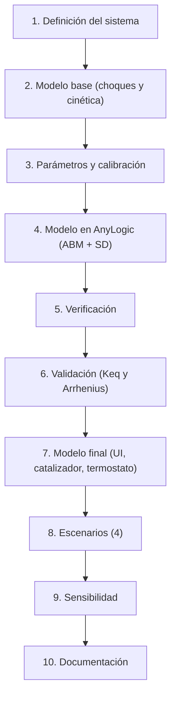

# Trabajo Práctico Integrador de Simulación - UTN

## Proyecto: Simulación Híbrida de Cinética de Reacciones Químicas, Equilibrio y Ley de Arrhenius en AnyLogic

## 1. Explicación Integral del Proyecto (Fundamentos Químicos y de Simulación)

### 1.1. Introducción para No Especialistas en Química

Una **reacción química** es un proceso en el cual una o más sustancias (**reactivos**) chocan con suficiente energía para romper sus enlaces y reorganizarse en otras sustancias (**productos**).

La **Cinética Química** estudia **la velocidad a la que ocurren las reacciones** y los mecanismos moleculares que la explican. Cinco factores determinan esa velocidad:

1. **Concentración de los reactivos:** más moléculas por unidad de volumen, más choques por segundo.
2. **Temperatura del reactor:** a mayor temperatura las moléculas van más rápido, hay más choques y una fracción mayor de ellos supera la barrera energética.
3. **Energía de Activación ($E_a$):** energía mínima que deben tener las moléculas en el impacto para que la reacción ocurra.
4. **Catalizador:** baja la energía de activación y acelera la reacción sin consumirse.
5. **Reversibilidad y equilibrio:** al acumularse el producto, este también se descompone, hasta llegar a un **equilibrio dinámico**.

---

### 1.2. El Sistema Químico Seleccionado

Reacción bimolecular reversible de segundo orden:

$$A + B \underset{k_2}{\overset{k_1}{\rightleftharpoons}} C$$

* **$A$ (azul)** y **$B$ (amarillo):** reactivos.
* **$C$ (verde):** producto de la unión de $A$ y $B$.
* **Reacción directa ($A + B \to C$):** ocurre cuando $A$ choca con $B$ y la energía cinética relativa a lo largo de la línea de choque supera $E_{a,1}$.
* **Reacción inversa ($C \to A + B$):** descomposición espontánea de $C$ con probabilidad por paso $1-\exp(-k_2\,dt)$, donde $k_2 = \mathcal{A}_2\exp(-E_{a,2}/k_BT)$.

---

### 1.3. Las Ecuaciones Matemáticas del Fenómeno

#### A. Ley de Acción de Masas (macroscópica)

$$\frac{dA}{dt} = -k_1 A B + k_2 C \qquad \frac{dB}{dt} = -k_1 A B + k_2 C \qquad \frac{dC}{dt} = +k_1 A B - k_2 C$$

En el equilibrio:

$$K_{eq} = \frac{C_{eq}}{A_{eq}B_{eq}} = \frac{k_1}{k_2}$$

El modelo trabaja con **conteos de moléculas** (no concentraciones molares), por lo que la constante efectiva es $k_{1c} = k_1/(L_x L_y)$ y $K_{eq} = k_{1c}/k_{2c}$ tiene unidades de 1/partículas. Como en este modelo no se define $\Delta G^\circ$, **la $K_{eq}$ teórica es $k_1/k_2$**.

El valor de $C$ en el equilibrio que predicen las EDO sale de resolver $K(a-C)(b-C)=C$, con $a = N_{A,0}+N_{C,0}$ y $b = N_{B,0}+N_{C,0}$:

$$C_{eq} = \frac{\big(K(a+b)+1\big) - \sqrt{\big(K(a+b)+1\big)^2 - 4K^2ab}}{2K}$$

#### B. Constante cinética por teoría de colisiones (2D) y Arrhenius

Para esferas duras en 2D con umbral de energía a lo largo de la línea de centros:

$$k_1(T) = (r_A + r_B)\sqrt{\frac{2\pi k_B T}{\mu}}\;\exp\!\left(-\frac{E_{a,1}}{k_B T}\right), \qquad k_2(T) = \mathcal{A}_2\exp\!\left(-\frac{E_{a,2}}{k_B T}\right)$$

con $\mu = m_Am_B/(m_A+m_B)$. El factor pre-exponencial $\propto\sqrt{T}$ es el que la teoría de colisiones agrega a la forma de Arrhenius pura. Por eso hay **dos pendientes de Arrhenius** (ver Paso 6):

* $\ln k_1$ contra $1/T$: pendiente aproximada $-480$ (con los parámetros usados).
* $\ln(k_1/\sqrt{T})$ contra $1/T$: pendiente exacta $-E_{a,1}/k_B = -400$.

---

### 1.4. ¿Por qué AnyLogic es la Plataforma Ideal?

1. **Nivel microscópico (agentes):** las moléculas son agentes que se mueven y chocan en un recinto 2D; el ruido molecular se ve directamente.
2. **Nivel macroscópico (dinámica de sistemas):** en el mismo modelo, stocks `A_sd`, `B_sd`, `C_sd` resuelven las EDO de acción de masas en paralelo.
3. **Contraste:** los gráficos superponen la curva teórica suave (SD) con la curva estocástica (agentes), mostrando cómo la ley macroscópica emerge de los choques individuales.

---

## 2. Desarrollo Paso a Paso Según la Metodología de Simulación



---

### Paso 1: Definición del Sistema Bajo Estudio

* **Objetivo:** modelar la cinética de $A + B \rightleftharpoons C$ y analizar el efecto de la concentración inicial, la temperatura y un catalizador sobre la velocidad y sobre el equilibrio.
* **Límites:** reactor cerrado 2D de $L_x \times L_y = 400 \times 450$ (área 180000), paredes elásticas no reactivas y termostato que fija la temperatura $T$ del medio.
* **Entidades:**
  - **Agente `Molecule`:** posición, velocidad $(v_x, v_y)$, especie (0 = A, 1 = B, 2 = C), masa, radio, bandera `dead`.
  - **`Main`:** temperatura $T$, $E_{a,1}$, $E_{a,2}$, estado del catalizador, conteos $c_A, c_B, c_C$, stocks SD y estadísticas.
* **Variables:**
  - *Entrada:* $N_{A,0}, N_{B,0}, N_{C,0}$, $T$, $E_{a,1}$, $E_{a,2}$, `catDelta`, $\mathcal{A}_2$, `nu`.
  - *Salida:* $c_A(t), c_B(t), c_C(t)$, $t_{1/2}$, $t_{eq}$, $\hat K_{eq}$, $k_1$ medida, velocidades de reacción instantáneas.
* **Hipótesis:**
  - El choque $A$-$B$ reacciona **solo si** $E_{rel}\ge E_{a,1}$. No se agrega además una probabilidad $\exp(-E_{a,1}/k_BT)$, porque eso cuenta la barrera dos veces.
  - La temperatura está **en unidades reducidas** ($k_B = 1$), no en Kelvin.

---

### Paso 2: Modelo de Simulación Base (Conceptual)

* **Movimiento y termalización:** velocidades iniciales de Maxwell 2D: cada componente $\sim N(0, k_BT/m)$. Se agrega un **termostato de Andersen**: en cada paso, cada molécula resamplea su velocidad con probabilidad $1-\exp(-\nu\,dt)$. Sin él, la reacción $2\to1$ enfriaría el gas sin límite y el slider de $T$ no controlaría el sistema.
* **Reacción directa:** al chocar $A$ y $B$ (distancia $\le r_A+r_B$), se calcula
  $$E_{rel} = \tfrac12\mu\,(\vec v_{rel}\cdot\hat n)^2$$
  y si $E_{rel}\ge E_{a,1}$: $A$ pasa a $C$ en el centro de masa, conserva el momento ($\vec v_C = (m_A\vec v_A+m_B\vec v_B)/(m_A+m_B)$) y $B$ se elimina.
* **Reacción inversa:** $C\to A+B$ con probabilidad $1-\exp(-k_2\,dt)$ por paso. Los productos nacen separados (sin solapamiento) en direcciones opuestas, con velocidad relativa muestreada de Maxwell (masa reducida $\mu$) y el momento de $C$ conservado en el centro de masa.
* **Catalizador:** Baja $E_{a,1}$ **y** $E_{a,2}$ en la misma cantidad (`catDelta = 240`, 60 % de $E_{a,1}$). Si solo bajara $E_{a,1}$, cambiaría $K_{eq}$, y un catalizador real no lo cambia: solo acelera ambos sentidos.

---

### Paso 3: Recolección de Datos y Calibración (Parámetros)

Unidades reducidas, $k_B = 1$:

| Parámetro | Valor | Nota |
|---|---|---|
| $L_x \times L_y$ | 400 × 450 | área 180000 |
| $N_{A,0} = N_{B,0}$ | 150 | $N_{C,0}=0$ |
| Masas $A, B, C$ | 1, 1, 2 | $m_C = m_A+m_B$ (conserva el momento) |
| Radios $A, B, C$ | 4, 4, 6 | |
| $T$ (por defecto) | 200 | slider 50–500 |
| $E_{a,1}$ | *00 |
| $E_{a,2}$ | 600 |
| `catDelta` | 240 | baja ambas barreras |
| $\mathcal{A}_2$ | 1.0 | 1/s |
| `nu` (termostato) | 7 | elegido entre 5 y 10 |
| `dt` | 0.02 s | paso del evento de física |
| `densCorr` | false | ver abajo |

* **Por qué $E_a = 400$ y 600:** con $E_a=100$ y $T\in[100,500]$ la relación $E_a/k_BT$ queda entre 0.2 y 1 y no se ve comportamiento de Arrhenius.
* **Corrección de densidad (descartada):** se probó un factor de contacto de Henderson ($\approx 1.24$) sobre $k_1$. La $k_1$ medida queda a 0–5 % de la fórmula diluida, y con la corrección activa $K_{eq}$ daba −15 % respecto de la teoría. Se deja `densCorr = false`.
* **Valor de `nu`:** con `nu = 1` la energía cinética media en equilibrio es 192 y no $k_BT = 200$ (la reacción consume energía cinética); con 5 es 198, con 10 es 199. Se eligió 7.
* **Curvas teóricas:** las EDO se integran dentro del modelo con la dinámica de sistemas (stocks en modo *Custom equation*), y se comparan además con una integración numérica independiente en Python.

---

### Paso 4: Modelo en AnyLogic (ABM + SD)

* **`Molecule`:** `species`, `mass`, `rad`, velocidad, `dead`; color azul/amarillo/verde según especie.
* **`Main`:**
  - Población `molecules` ($N_{A,0}$ A + $N_{B,0}$ B).
  - Evento cíclico `stepEvent` (cada `dt`): mueve, rebota en paredes, termostato, reacción inversa, colisiones $O(N^2)$, limpieza y **recuento real** de $c_A, c_B, c_C$ y de los errores de balance.
  - Evento cíclico `sampleEvent` (cada 0.1 s): velocidades de reacción, lógica de escenarios, $t_{1/2}$, $t_{eq}$ y acumulación de estadísticas después de `tEq`.
  - Stocks SD `A_sd`, `B_sd`, `C_sd` con las EDO.
  - 3 gráficos: agentes contra SD, convergencia de $C$ al equilibrio y constante de equilibrio.
  - Indicadores de texto: conversión, $t_{1/2}$, $t_{eq}$, $K_{eq}$ estimada y teórica, error, balance de átomos, $r_C$, $r_A$ y $r_C$ teórica (SD).
  - Controles: slider de $T$, catalizador (activar/quitar), inyección de +50 A y +50 B.
* **Física en un evento cíclico, no en "On step":** el movimiento y las colisiones están en `stepEvent` para tener control del paso `dt`.

---

### Paso 5: Verificación del Modelo

La verificación se apoya en los cálculos de una **réplica independiente en Python** (mismas reglas, escrita aparte) y en indicadores incorporados al modelo. **No se corrieron experimentos de verificación en AnyLogic.**

* **Balance de átomos:** el modelo calcula `balanceErrA = (cA + cC) − totalA` y `balanceErrB = (cB + cC) − totalB` en cada paso, y se muestran en pantalla; deben valer 0. En los experimentos del Escenario 2 los promedios por corrida cumplen $\langle A\rangle+\langle C\rangle=200$ y $\langle B\rangle+\langle C\rangle=50$ en las 10 corridas.
* **Conservación del momento:** al reaccionar, $C$ toma $\vec v = (m_A\vec v_A+m_B\vec v_B)/M$ y al descomponerse se conserva el momento del centro de masa. Se corrigió `masaC = 1` a `2`, que rompía la conservación.
* **Ausencia de reacción en frío:** a $T$ muy bajo $E_{rel}$ no alcanza $E_{a,1}$ y no se forma $C$ (propiedad del criterio de umbral).
* **Ecuaciones (réplica en Python):**
  - $k_1$ medida / $k_1$ diluida $= 1.045,\ 1.040,\ 1.021,\ 1.047,\ 0.969$ para $T = 100, 150, 200, 250, 300$ (±4 %): la fórmula de colisiones es correcta.
  - $C_{eq}$ a $T = 200$: 65.3 teórico contra 65.6–66.8 simulado.
  - $K_{eq}$ a $T = 200$: $9.6\times10^{-3}$ simulado contra $9.1\times10^{-3}$ teórico (+5.8 %, 3 réplicas).

---

### Paso 6: Validación del Modelo

* **$K_{eq}$:** se mide $\hat K_{eq}$ con dos estimadores.
  - *Exacto:* $\langle C\rangle/\langle A\cdot B\rangle$, que sale del balance de velocidades medias $k_1\langle AB\rangle = k_2\langle C\rangle$.
  - El test $t$ de Student se hace **entre réplicas** (10 réplicas con semillas distintas), porque las muestras dentro de una corrida están autocorrelacionadas.
* **Arrhenius:**  $k_1$ se mide como $n_{react}/\int A\,B\,dt$ (reacciones directas sobre la integral de $A\cdot B$), no como $\Delta N_C/\Delta t$ de un intervalo corto, que es mucho más ruidoso. Se hacen dos ajustes (ver 1.3.B). Pendientes medidas en la réplica: $-473$ (teórica $-480$) y $-393$ (teórica $-400$), $R^2=0.9995$.
* **Velocidad inicial en el modelo:** el modelo mide $k_1$ con `nTarget = 100` reacciones desde `tV0Start = 2 s`, con `batchMode` para cortar la corrida y un reporte de Arrhenius en `Main`.

---

### Paso 7: Modelo Final (UI, Catalizador y Controles)

* **Slider de $T$:** llama a `resetStats()` para reiniciar el promedio, porque cada perturbación cambia el equilibrio.
* **Catalizador / Quitar catalizador:** `catalystOn = true/false; resetStats();`.
* **Inyección de A o B:** crea moléculas nuevas, actualiza `totalA`/`totalB` y los stocks SD y reinicia estadísticas, $t_{1/2}$ y $t_{eq}$.
* **Escenarios automáticos:** parámetro `escenario` (0 = manual, 3 o 4) con `tCat`, `t4Pulso`, `nPulso`, `t4Enfriar` y `T4frio`.
* **Indicadores de velocidad instantánea:** $r_C$ y $r_A$ son medias móviles exponenciales de 2 s de las reacciones directas e inversas por segundo; $r_C$ teórica sale de la SD.
* **Utilidades de réplicas** en `Main`: `runsClear`, `runsAdd` y `runsReport` (CSV, media y desvío por grupo y test $t$ pareado), usadas por los experimentos *Parameters Variation*.

---

### Paso 8: Determinación de Escenarios para el Análisis

Los cuatro escenarios, con los parámetros efectivamente usados (10 réplicas con semillas distintas cada uno):

| Escenario | Configuración |
|---|---|
| 1. Temperatura | $T = 100, 200, 300, 400$; `tEq` = 300 s; parada 600 s. Repetición de $T=100$ con `tEq` = 900 s y parada 1500 s |
| 2. Reactivo limitante | $N_A = 200$, $N_B = 50$; `tEq` = 100 s; parada 400 s |
| 3. Catalizador | $T = 100$; catalizador a `tCat` = 50 s; parada 100 s; comparación `escenario` 0 contra 3 |
| 4. Perturbaciones (Le Chatelier) | $T = 200$; pulso de `nPulso` = 100 A a $t$ = 150 s; enfriamiento a $T$ = 100 a $t$ = 450 s. Primera versión: `tEq` = 150 s, parada 900 s. Repetición: `tEq` = 450 s, parada 1500 s |

---

### Paso 9: Análisis de Sensibilidad

* **Volumen (réplica en Python):** al reducir el reactor a la mitad con el mismo $N$, las reacciones por segundo se multiplican por $\approx 2.3$ y la velocidad por unidad de área por $\approx 4.5$.
* **$E_a$ y $N$:** quedan como análisis opcional (la exponencial de $E_a$ ya se ve en la dependencia con $T$ del Escenario 1; para $N=1000$ hay que agrandar el reactor, con 1000 partículas en 400 × 450 la ocupación del área es ≈28 %). **No se corrieron en AnyLogic.**

---

### Paso 10: Documentación Final y Conclusiones

Informe en PDF tipo paper (abstract, objetivos, metodología, resultados y conclusiones, con los diez pasos de forma implícita), la planilla `Resultados_Quimica.xlsx` con las corridas, y el modelo `QuimicaCinetica.alp`.

---

## 3. Código Java Clave Implementado en AnyLogic

Todo vive en `Main`. Estas son las piezas centrales, tal como están en el modelo.

### 3.1. Evento `stepEvent` (cada `dt`)

```java
// 1) Movimiento y paredes
for (Molecule m : molecules) {
    double x = m.getX() + m.vx * dt;
    double y = m.getY() + m.vy * dt;
    if (x < m.rad)      { x = m.rad;      m.vx =  Math.abs(m.vx); }
    if (x > Lx - m.rad) { x = Lx - m.rad; m.vx = -Math.abs(m.vx); }
    if (y < m.rad)      { y = m.rad;      m.vy =  Math.abs(m.vy); }
    if (y > Ly - m.rad) { y = Ly - m.rad; m.vy = -Math.abs(m.vy); }
    m.setXY(x, y);
}

// 2) Termostato de Andersen (fija la temperatura del medio = slider T)
double kT  = kB * T;
double pTh = 1 - Math.exp(-nu * dt);
for (Molecule m : molecules) {
    if (random() < pTh) {
        double sg = Math.sqrt(kT / m.mass);
        m.vx = sg * gauss();
        m.vy = sg * gauss();
    }
}

// 3) Reacción inversa  C -> A + B  (probabilidad por paso)
double k2   = A2 * Math.exp(-getEa2() / kT);
double pDec = 1 - Math.exp(-k2 * dt);
int n0 = molecules.size();
for (int i = 0; i < n0; i++) {
    Molecule c = molecules.get(i);
    if (c.species == 2 && random() < pDec) decompose(c);
}

// 4) Colisiones (O(N^2): alcanza para N <= 1000)
int n = molecules.size();
for (int i = 0; i < n - 1; i++) {
    Molecule a = molecules.get(i);
    if (a.dead) continue;
    for (int j = i + 1; j < n; j++) {
        Molecule b = molecules.get(j);
        if (b.dead || a.dead) continue;
        double dx = b.getX() - a.getX();
        double dy = b.getY() - a.getY();
        double d  = a.rad + b.rad;
        if (dx * dx + dy * dy < d * d) collide(a, b, dx, dy);
    }
}

// 5) Limpiar eliminadas y recontar (conteo real, no incremental)
for (int i = molecules.size() - 1; i >= 0; i--) {
    Molecule m = molecules.get(i);
    if (m.dead) remove_molecules(m);
}
cA = 0; cB = 0; cC = 0;
for (Molecule m : molecules) {
    if (m.species == 0) cA++; else if (m.species == 1) cB++; else cC++;
}
balanceErrA = (cA + cC) - totalA;    // debe ser 0
balanceErrB = (cB + cC) - totalB;    // debe ser 0

// 6) Medición de k1
if (time() >= tV0Start && !v0Done) intAB += (double) cA * cB * dt;
if (!v0Done && nReact >= nTarget) { v0Done = true; tV0End = time(); }
if (batchMode && v0Done) finishSimulation();
```

### 3.2. Colisión y reacción directa

```java
// collide(Molecule a, Molecule b, double dx, double dy)
double dist = Math.sqrt(dx * dx + dy * dy);
if (dist < 1e-9) { dx = 1; dy = 0; dist = 1; }
double nx = dx / dist, ny = dy / dist;

// velocidad relativa normal (negativa = se acercan)
double vn = (b.vx - a.vx) * nx + (b.vy - a.vy) * ny;
if (vn >= 0) return;                       // ya se alejan: no hay choque

boolean ab = (a.species == 0 && b.species == 1) || (a.species == 1 && b.species == 0);
if (ab) {
    double mu = a.mass * b.mass / (a.mass + b.mass);
    double eRel = 0.5 * mu * vn * vn;
    if (eRel >= getEa1()) { react(a, b); return; }
}

// choque elástico (impulso a lo largo de la normal)
double J = -2 * vn / (1 / a.mass + 1 / b.mass);
a.vx -= J / a.mass * nx;  a.vy -= J / a.mass * ny;
b.vx += J / b.mass * nx;  b.vy += J / b.mass * ny;

// separar el solapamiento
double ov = 0.5 * (a.rad + b.rad - dist);
a.setXY(a.getX() - nx * ov, a.getY() - ny * ov);
b.setXY(b.getX() + nx * ov, b.getY() + ny * ov);
```

```java
// react(Molecule a, Molecule b):  A + B -> C
double M  = a.mass + b.mass;                       // masas ANTES de cambiar nada
double px = (a.mass * a.vx + b.mass * b.vx) / M;
double py = (a.mass * a.vy + b.mass * b.vy) / M;
double cx = (a.mass * a.getX() + b.mass * b.getX()) / M;
double cy = (a.mass * a.getY() + b.mass * b.getY()) / M;

a.setSpecies(2);              // ahora mass = 2, rad = 6
a.vx = px;  a.vy = py;
a.setXY(cx, cy);
b.dead = true;                // se elimina al final del paso
if (time() >= tV0Start && !v0Done) nReact++;
nFwd++;
```

### 3.3. Reacción inversa $C \to A + B$

```java
// decompose(Molecule c)
nRev++;
double ma = masaA, mb = masaB, M = ma + mb, mu = ma * mb / M;
double ang = random() * 2 * Math.PI;
double ux = Math.cos(ang), uy = Math.sin(ang);

// velocidad relativa muestreada de Maxwell (masa reducida mu), forzada a "alejarse"
double sg = Math.sqrt(kB * T / mu);
double rx = sg * gauss(), ry = sg * gauss();
double rn = rx * ux + ry * uy;
if (rn < 0) { rx -= 2 * rn * ux; ry -= 2 * rn * uy; }

double cx = c.getX(), cy = c.getY();
double vcx = c.vx, vcy = c.vy;             // el CM conserva el momento de C
double sep = radioA + radioB + 0.1;        // NO nacen solapadas

Molecule b = add_molecules();
b.setSpecies(1);
c.setSpecies(0);

c.setXY(cx - mb / M * sep * ux, cy - mb / M * sep * uy);
b.setXY(cx + ma / M * sep * ux, cy + ma / M * sep * uy);

c.vx = vcx - mb / M * rx;  c.vy = vcy - mb / M * ry;
b.vx = vcx + ma / M * rx;  b.vy = vcy + ma / M * ry;
```

### 3.4. Energías de activación, constantes y equilibrio teórico

```java
// getEa1():  el catalizador baja LAS DOS barreras en la misma cantidad
return Ea1 - (catalystOn ? catDelta : 0);
// getEa2():
return Ea2 - (catalystOn ? catDelta : 0);

// k1Theory()
double mu = masaA * masaB / (masaA + masaB);
double dc = radioA + radioB;
return dc * Math.sqrt(2 * Math.PI * kB * T / mu) * Math.exp(-getEa1() / (kB * T));

// k1c()  (densCorr = false por defecto)       // k2c() = A2 * Math.exp(-getEa2() / (kB * T))
return (densCorr ? gContact() : 1.0) * k1Theory() / (Lx * Ly);

// KeqTeo()
return k1c() / k2c();

// CeqTeo():  resuelve K (a - C)(b - C) = C
double K = k1c() / k2c();
double a = totalA, b = totalB;
double bq = K * (a + b) + 1;
double disc = bq * bq - 4 * K * K * a * b;
return (bq - Math.sqrt(Math.max(disc, 0))) / (2 * K);

// KeqEstAB():  estimador exacto <C> / <A*B>
if (nSamp < 20 || sumAB <= 0) return 0;
return (sumC / nSamp) / (sumAB / nSamp);
```

### 3.5. Evento `sampleEvent` (cada 0.1 s)

```java
// Velocidades instantáneas (reacciones por segundo): media móvil exponencial, tau = 2 s
double aEma = 0.1 / 2.0;
rFwdAvg += aEma * (nFwd / 0.1 - rFwdAvg);
rRevAvg += aEma * (nRev / 0.1 - rRevAvg);
nFwd = 0;  nRev = 0;

// Escenarios automáticos (escenario = 0 deja el control manual)
if (escenario == 3 && !s3Done && time() >= tCat) {
    catalystOn = true;  resetStats();  s3Done = true;
}
if (escenario == 4) {
    if (!s4PulsoDone && time() >= t4Pulso) {
        for (int i = 0; i < nPulso; i++) spawn(0);
        totalA += nPulso;  A_sd += nPulso;
        resetStats();  s4PulsoDone = true;
    }
    if (!s4FrioDone && time() >= t4Enfriar) {
        set_T(T4frio);  resetStats();  s4FrioDone = true;
    }
}

// t_1/2: primer instante en que C llega a la mitad de su valor de equilibrio
if (tHalf < 0 && CeqTeo() > 0 && cC >= 0.5 * CeqTeo()) tHalf = time();
// guía de t_eq: primer instante en que la SD llega al 98 % del equilibrio
if (tEqSD < 0 && CeqTeo() > 0 && C_sd >= 0.98 * CeqTeo()) tEqSD = time();

// acumular después del período de espera
if (time() >= tStats) {
    sumA += cA;  sumB += cB;  sumC += cC;
    sumAB += (double) cA * cB;
    nSamp++;
}
```

`resetStats()`: `sumA = 0; sumB = 0; sumC = 0; sumAB = 0; nSamp = 0; tStats = time() + tEq;`

---

## 4. Resultados de los Escenarios

Todas las corridas son de 10 réplicas con semilla aleatoria distinta. Las tablas están calculadas en `Resultados_Quimica.xlsx`. El test es $t$ de Student **pareado** por réplica contra el valor teórico (crítico 2.262 para 9 grados de libertad, 5 %), salvo el Escenario 3, que compara dos grupos independientes con el test de Welch. Los valores teóricos de $t_{1/2}$ y de $C$ promediada en la ventana salen de integrar las EDO con $L_xL_y=180000$.

### Escenario 1: Temperatura

| $T$ | $t_{1/2}$ agentes (s) | $t_{1/2}$ EDO (s) | $C$ medio | $C_{eq}$ teórico | Error | $t$ pareado |
|---|---|---|---|---|---|---|
| 100 | 94.6 ± 16.1 (ventana corta); 80.0 ± 11.8 (ventana larga) | 81.7 | 65.04 (corta); **71.42 (larga)** | 71.58 | −9.1 % (corta); **−0.2 %** (larga) | −6.13 (rechaza); **−0.15** (no rechaza) |
| 200 | 7.34 ± 1.66 | 5.9 | 53.81 | 54.84 | −1.9 % | −1.82 (no rechaza) |
| 300 | 2.58 ± 0.94 | 2.3 | 51.97 | 51.53 | +0.8 % | 1.05 (no rechaza) |
| 400 | 1.84 ± 0.57 | 1.4 | 51.54 | 50.96 | +1.1 % | 2.53 (rechaza, diferencia irrelevante) |

* La ventana corta de $T=100$ (promedio entre 300 y 600 s) incluye la subida: la SD llega al 98 % de $C_{eq}$ recién a los 522 s. Con ventana larga (900–1500 s) la coincidencia es de 0.2 %.
* A $T\ge200$ los agentes coinciden con la teoría a menos de 2 %. El rechazo de $T=400$ es una diferencia de 1.1 %, estadísticamente detectable por la poca varianza pero sin relevancia práctica.
* Las dos tandas de $T=100$ dieron $t_{1/2}$ distintos (Welch $t=2.33$, crítico 2.12): el $t_{1/2}$ varía entre tandas más de lo que sugiere un solo desvío. Para $T=200$–$400$ los agentes dieron $t_{1/2}$ entre 12 y 31 % mayor que la EDO en una sola tanda, sin repetir; la causa no está verificada.

### Escenario 2: Reactivo limitante ($N_A=200$, $N_B=50$)

| | Agentes | Teoría |
|---|---|---|
| $C$ medio | 25.25 ± 0.43 | 25.68 |
| $A$ medio / $B$ medio | 174.75 / 24.75 | – |

* $C$ **no llega a 50**: por la reversibilidad se estabiliza en ≈25 y sobran ≈25 de $B$ y ≈175 de $A$. Esto es una consecuencia del equilibrio y no un error: la reacción reversible no consume todo el reactivo limitante.
* Error −1.7 %, $t=-3.21$ (rechaza H0 con $t_{crit}=2.262$, por la poca varianza). La ventana (100–400 s) está pasada la relajación, así que el sesgo no se explica por eso; causa no verificada (también apareció en el Escenario 1 con $T=200$).
* El balance de átomos se cumple en las 10 corridas.

### Escenario 3: Catalizador ($T=100$, activado a $t=50$ s)

| | Sin catalizador | Con catalizador |
|---|---|---|
| $C$ a $t=100$ s | 38.8 ± 3.2 | 68.8 ± 3.0 |
| Avance hacia $C_{eq}$ (71.58) | 54 % | 96 % |

* Welch: $t=21.8$, 18 grados de libertad, crítico 2.11: el catalizador acelera de forma clara (≈1.8 veces el avance a $t=100$, habiendo actuado solo 50 s).
* Como baja ambas barreras en la misma cantidad, no cambia $K_{eq}$ ni $C_{eq}$. Este experimento muestra el efecto en la velocidad; la invarianza de $K_{eq}$ se desprende de la construcción del modelo y no se midió por separado.

### Escenario 4: Le Chatelier (pulso de A y enfriamiento)

| | Ventana corta (600–900 s) | Ventana larga (900–1500 s) |
|---|---|---|
| $K_{eq}$ exacta | 0.01079 ± 0.00126 | 0.01152 ± 0.00124 |
| $K_{eq}$ teórica | 0.01164 | 0.01164 |
| Error de $K_{eq}$ | −7.4 % | **−1.0 %** |
| $t$ pareado (crítico 2.262) | −2.15 | −0.30 |
| Error de $C$ medio | −2.4 % | −0.4 % |

* Tras el pulso de A ($N_A$ pasa de 150 a 250), el sistema consume $B$ y produce más $C$, y $C_{eq}$ teórico sube a 96.24. Al enfriar, el equilibrio se desplaza hacia $C$, el lado exotérmico ($\Delta H<0$): $K_{eq}$ crece al bajar $T$.
* El sesgo de la primera versión era de la ventana: a $T=100$ la relajación es lenta y con solo 150 s de espera se promedia parte de la subida. Con 450 s de espera, $K_{eq}$ queda dentro del ruido de la teoría.
* Estos datos miden $K_{eq}$ solo al final; no comparan $K_{eq}$ antes y después del pulso.

---

## 5. Cambios Respecto del Planteo Original (para justificar en el informe)

| Tema | README original | Implementado | Motivo |
|---|---|---|---|
| $E_{a,1}$, $E_{a,2}$ | 100 y 150 | 400 y 600 | Con 100 y $T=100$–500, $E_a/k_BT$ es 0.2–1 y no se ve Arrhenius |
| Catalizador | Baja $E_{a,1}$ 60 % | Baja $E_{a,1}$ **y** $E_{a,2}$ en 240 | Un catalizador real no cambia $K_{eq}$ |
| Temperatura | Kelvin | Unidades reducidas ($k_B=1$) | Evitar $k_B\sim10^{-23}$ |
| Termostato | No | Andersen, `nu = 7` | Que el slider de $T$ controle el sistema y la reacción $2\to1$ no enfríe el gas |
| Criterio de reacción | $E_{rel}\ge E_a$ "o" probabilidad $\exp(-E_a/k_BT)$ | Solo umbral $E_{rel}\ge E_{a,1}$ | La probabilidad cuenta la barrera dos veces |
| $K_{eq}$ teórica | $\exp(-\Delta G^\circ/RT)$ | $k_1/k_2$ | En el modelo no se define $\Delta G^\circ$ |
| Estimador de $K_{eq}$ | $\langle C\rangle/(\langle A\rangle\langle B\rangle)$ | Exacto $\langle C\rangle/\langle A\cdot B\rangle$, y se muestran los dos | Sesgo de $\mathrm{Var}(C)/(\langle A\rangle\langle B\rangle)$ del estimador del README |
| Medición de $k_1$ | $v_0=\Delta N_C/\Delta t$ en intervalo corto | $n_{react}/\int AB\,dt$ | Mucho menos ruido |
| Arrhenius | Un ajuste, pendiente $-E_a/k_B$ | Dos ajustes: $\ln k$ (≈ −480) y $\ln(k/\sqrt T)$ (−400) | El factor $\sqrt T$ de la teoría de colisiones |
| Densidad | — | Corrección de Henderson probada y descartada (`densCorr = false`) | $K_{eq}$ salía −15 % de la teoría |
| `masaC` | — | 2 (= $m_A+m_B$) | Con 1 se rompía la conservación del momento |
| Recuento | Incremental (`countA--`) | Recuento real cada paso, más `balanceErrA/B` | Detecta cualquier creación o pérdida indebida |
| Escenario 1 | $T$ = 100, 200, 400 | $T$ = 100, 200, 300, 400 | Más puntos para ver la tendencia |
| Escenario 4 | Pulso y enfriamiento tras equilibrio | Automatizado con parámetros (`escenario = 4`) | Reproducible en réplicas |
| Volumen $/2$ | "Velocidad ×4" | ×2.3 en conteos; ×4.5 por unidad de área | El ×4 vale para concentraciones, no para el conteo; la mayor densidad agrega un exceso |
| Área del reactor | — | $L_x\times L_y=400\times450$ | Fijada para todo el informe |

---

## 6. Limitaciones y Puntos Abiertos

* **Verificación y validación:** se apoyan en una réplica independiente en Python y en los indicadores del modelo; **no se hicieron corridas dedicadas en AnyLogic** (captura del balance de átomos, prueba con $T=1$, experimentos de Arrhenius y de $K_{eq}$).
* **$t_{1/2}$ a $T=200$–$400$:** los agentes dan 12–31 % más que la EDO en una sola tanda de 10 réplicas, sin repetir y sin causa verificada. A $T=100$, una segunda tanda quedó a 2 % de la EDO.
* **Sesgo de −1.7 % / −1.9 %** en $C$ a $T=200$ (Escenarios 1 y 2), con signo consistente y causa no verificada (hipótesis: termostato o discretización de `dt`).
* **Sensibilidad a $E_a$ y $N$:** no corrida.
* **Escenario 4:** no se compara $K_{eq}$ antes y después del pulso.
* **Dependencia de la ventana de promedio:** a $T$ bajo la relajación es lenta (a $T=100$ la SD tarda ≈522 s en llegar al 98 %), y `tEq` debe ser mayor que ese tiempo para que el promedio sea de equilibrio.

---

## 7. Archivos del Proyecto

| Archivo | Contenido |
|---|---|
| `QuimicaCinetica/QuimicaCinetica.alp` | Modelo AnyLogic (ABM + SD) |
| `Resultados_Quimica.xlsx` | Planilla de las corridas: `Parametros`, `Esc1_*`, `Esc1b_*`, `Esc2_*`, `Esc3_*`, `Esc4_*`, `Esc4b_*` |
| `Estado del TPI de Química.txt` | Registro del estado, decisiones y resultados |
| `Experimentos_AnyLogic.txt` | Guía para configurar los experimentos *Parameters Variation* |
| `readme.md` | Este documento |

**Configuración común de los experimentos:** Parameters Variation con *Replications per iteration* = 10, *Random seed (unique simulation runs)*, **Allow parallel evaluations desactivado** (la utilidad `runsAdd` usa una lista compartida), `Main.runsClear();` en *Initial experiment setup*, `Main.runsAdd(...)` en *After simulation run* y `Main.runsReport(...)` en *After experiment*.
